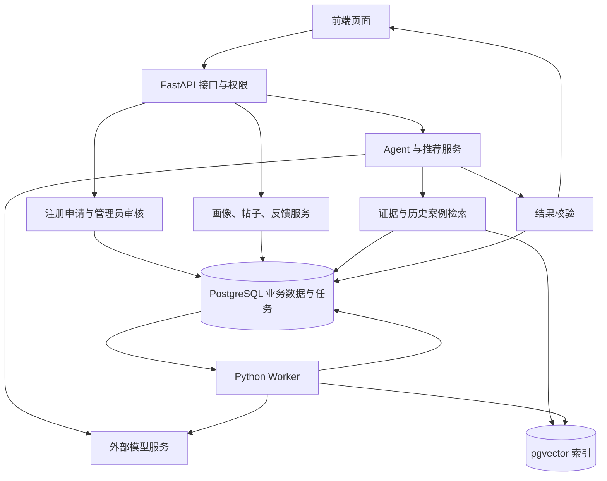
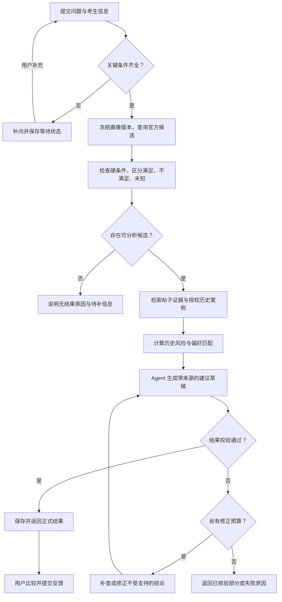
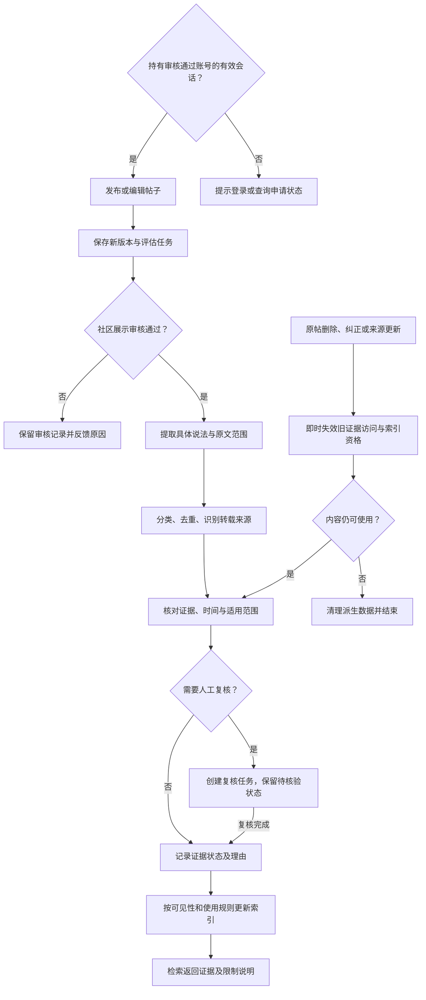
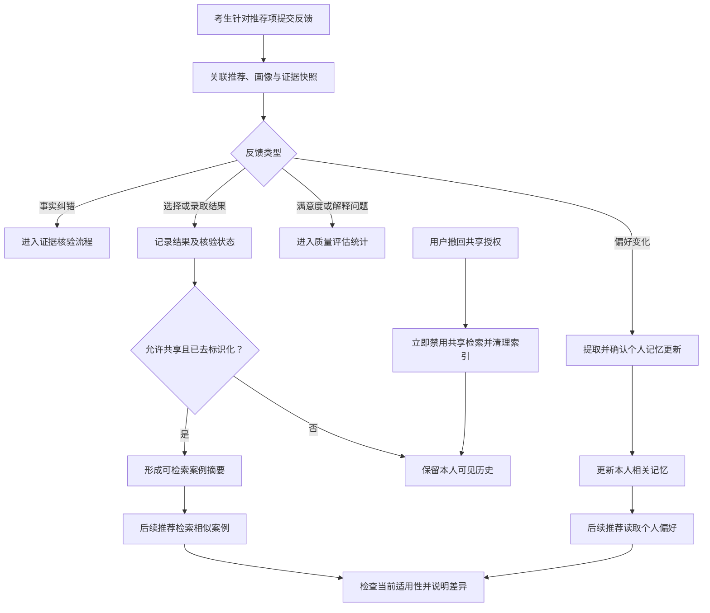
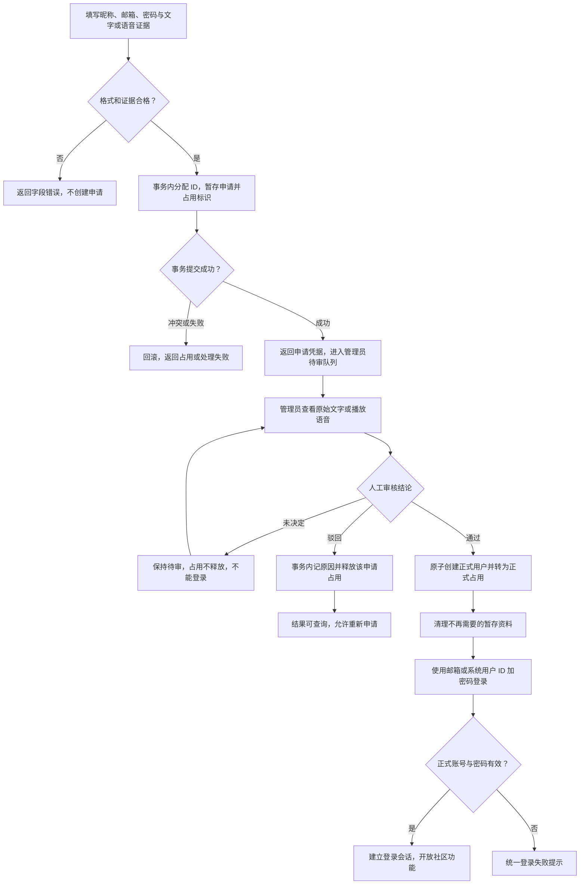

# 高考志愿报名信息查询与推荐

> 当前实现状态：2026-10-18 已增加 M0–M1 FastAPI/PostgreSQL 后端、真实接口联调与开发日志。第十一至十五章保留前端整合阶段历史；最新实现、兼容差异和未完成页面以第十六章及 [BACKEND.md](contracts/BACKEND.md) 为准。
本项目旨在使用大模型调用工具对高考报名的院校信息进行查询，同时使用项目提供的发帖信息进行综合，结合考生提供的信息和需求，给予推荐和建议，在这样一个系统里，考虑到公开信息的有限性，所以学长学姐提供的信息对于这个院校的真实情况更具有参考价值，拟采用帖子信息作为辅助的信息对结果的真实性和有效性进行增强；因此帖子的真实性和有效性就十分重要，可以作为一个单独的模块进行开发

## 一、技术分析
采用常用的前后端三层模型：
表示层 -> 服务层 -> 数据层

**表示层**：提供图形页面，调用后端服务

**服务层**：采用模块化的方法，实现基本功能，提供服务，写入数据

**数据层**：对数据进行存储，提供数据读写的方法

## 二、后端模块划分
拟将后端划分为如下的模块：

**考生画像与需求分析模块**：对于考生提供的信息进行结构化处理，并识别缺失的信息

**官方院校与招生数据获取模块**：检索公开的院校和招生信息，并保留年份做参考数据

**发帖与管理模块**：社区注册申请暂存、管理员人工审核、邮箱或系统 ID 登录，以及帖子管理；审核通过前不创建正式账号，证据接受文字或语音

**帖子的可信度评估与证据管理模块**：提取具体说法，核对证据，识别重复、冲突、过期和适用范围

**检索与知识服务模块**：按学校、校区、专业、时间等筛选，再结合关键词和语义检索寻找相关资料

**志愿匹配与推荐计算模块**：检查报考条件，评估历史录取风险，计算专业、地域和生活偏好的匹配情况

**Agent 编排与模型接入模块**：理解问题、补问关键信息、选择工具、执行查询、综合证据生成建议

**结果校验与反馈评估模块**：检查引用、数字、条件和结论是否一致；处理纠错；评估系统效果

**考生反馈与历史案例模块**：采集关联具体推荐的反馈，管理个人偏好记忆与授权历史案例，为后续检索增强提供数据；质量统计由结果校验与反馈评估模块负责

## 三、技术栈

前端已采用 **React 19＋TypeScript 5＋Vite 7** 单页应用，项目名称为“夜航 Night Voyage”。使用 React Context＋Hooks 管理状态、自定义 Hash 路由切换页面，原生 Fetch 对接 REST／SSE，原生 CSS、SVG、Web Animations API 及本地图片／视频实现交互，lucide-react 提供图标；没有引入 Next.js、Redux、React Router、Axios 或独立 Node.js 业务服务。

| 类别 | 声明版本／方式 | 当前锁文件版本与用途 |
| --- | --- | --- |
| React、React DOM | `^19.2.0` | 均锁定 `19.3.1`；组件渲染、Hooks、Context、懒加载 |
| TypeScript | `^5.9.3` | `5.9.3`；strict 类型检查，目标 ES2022，Bundler 模块解析 |
| Vite | `^7.1.12` | `7.3.7`；开发服务、API 代理、生产构建及页面拆包 |
| lucide-react | `^0.468.0` | `0.468.0`；界面图标 |
| Prettier | `^3.9.10` | `3.9.10`；代码格式化，当前未配置 ESLint |
| Node.js、pnpm | Node.js `>=22.18.0`；pnpm engines `>=10.26.0` | `packageManager` 指定 `pnpm@11.25.0`；团队安装优先使用该固定版本和锁文件 |
| 自动测试 | Node.js 内置 `node:test`、`assert` | 通过类型擦除运行 TypeScript 测试；HTTP／Mock 测试使用 esbuild 打包访问层 |
| 接口契约 | OpenAPI 3.1、手写 TypeScript 类型 | `scripts/contract.mjs` 生成 `docs/openapi.json`；尚未从正式后端生成类型 |

版本依据仓库 `src/frontend/package.json` 和 `src/frontend/pnpm-lock.yaml`，表示本项目声明与锁定结果，不表示推荐升级到这些版本。完整前端实现、开发要点及接口差距见第十一至十三章。

后端：使用python编写主要业务逻辑，并用FastAPI提供模块的接口
数据库：使用PostgreSQL进行数据存储

版本管理：使用 Git，GitHub 仓库为 [Passcaval/GKRsysterm](https://github.com/Passcaval/GKRsysterm)。采用单仓库管理，前后端代码统一位于 `src/` 下，分别存放在 `src/frontend/` 和 `src/backend/`。
AI辅助工具：使用Codex、Claude code，DSH等AI工具辅助完成

各模块的实施设计、前后端协同、系统工作流程及 AI 编程工具协作约定见下文。

## 四、开发范围与统一约定

本节起为 2026-10-18 补充的实施设计，描述拟开发的行为和验收要求，不表示功能已实现。保留原方案的 Python、FastAPI、PostgreSQL 及既有前端框架；新增的组件均为建议选型。

**阅读口径：** 第四至九章为目标业务规范；第十一至十三章记录前端核查、差距评估及改造要求；第十四章记录随后实施的统一登录更新，登录相关现状以该章为准。其他前端接口与目标规范仍有冲突，不能把现有前端契约直接作为后端完整实施规范。

### 4.1 第一版范围

先支持一个明确省份、一个招生年份和普通类招生场景，选择一批能取得可靠数据的院校完成闭环。招生省份、选科制度、批次及投档单位确定后，再实现对应规则适配器；其他省份和特殊类型招生先标为未覆盖。第一版输出辅助选择的候选方案，不执行真实志愿提交，也不宣称计算出了精确录取概率。

官方资料用于确认报考要求、计划、学费等事实；学生帖子用于补充特定校区、专业、年份的经历和体验。未能核验的信息保留“未知”“有争议”状态。身份认证、帖子热度和大模型自报置信度均不能直接证明内容真实。

### 4.2 后端组织与基础组件

采用模块化单体：一个 FastAPI 应用对外提供接口，九个业务模块在进程内通过服务方法协作。独立 Python Worker 处理资料导入、帖子评估、向量化及推荐任务，复用同一套业务代码。第一版用 PostgreSQL 任务表持久化任务，后续确有吞吐需求时再接入专用任务队列。

| 组件 | 建议与职责 | 引入时机 |
| --- | --- | --- |
| Python、FastAPI、Uvicorn | 业务实现、HTTP 接口、运行服务 | 基础阶段 |
| Pydantic | 请求、响应、模型结构化输出和工具参数校验 | 基础阶段 |
| SQLAlchemy、PostgreSQL 驱动、Alembic | 数据访问、事务、数据库结构迁移；驱动与同步或异步模式统一 | 基础阶段 |
| 模型供应商 SDK 或 HTTPX | 封装模型接口、超时、错误、工具调用和用量记录 | Agent 阶段 |
| PostgreSQL＋pgvector | 保存业务数据与文本向量；生成向量另需 Embedding 模型 | 检索阶段 |
| PostgreSQL jobs＋Python Worker | 任务持久化、领取、重试和恢复 | 异步处理阶段 |
| pytest 等测试工具 | 规则、权限、接口契约和关键流程回归 | 各开发阶段 |

FastAPI 可以用 APIRouter 组织不同模块，数据库迁移由 Alembic 管理。若使用 SQLAlchemy AsyncSession，每个请求或并发任务使用独立 Session；不要在多个并发模型工具调用中共享同一个 Session。[1][2][3]

后端项目根目录为 `src/backend/`。以下路径均相对于 Git 仓库根目录，按业务划分模块：

| 路径 | 内容 |
| --- | --- |
| `src/backend/app/main.py` | 应用入口、路由注册、启动与关闭资源 |
| `src/backend/app/core/` | 配置、身份校验、权限、日志、错误类型 |
| `src/backend/app/db/` | 数据库连接、Session、公共模型 |
| `src/backend/app/modules/profiles/` | 考生画像与需求分析 |
| `src/backend/app/modules/admissions/` | 官方资料和招生数据 |
| `src/backend/app/modules/community/` | 帖子、评论、作者认证和审核 |
| `src/backend/app/modules/evidence/` | 具体说法、证据关系和核验记录 |
| `src/backend/app/modules/retrieval/` | 分块、索引、混合检索和重排 |
| `src/backend/app/modules/recommendation/` | 条件检查、历史风险和偏好匹配 |
| `src/backend/app/modules/agent/` | 模型适配、工具注册、状态机和预算 |
| `src/backend/app/modules/validation/` | 答案检查、评测集和评测报告 |
| `src/backend/app/modules/history/` | 反馈、偏好记忆和历史案例 |
| `src/backend/app/workers/` | 任务领取、租约、重试和任务入口 |
| `src/backend/migrations/` | Alembic 数据库迁移脚本；迁移配置放在 `src/backend/alembic.ini` |
| `src/backend/tests/` | 后端单元测试、集成测试及关键业务流程回归 |
| `docs/contracts/` | 前后端共享的接口、错误码与事件契约 |

每个业务模块可包含 `router.py`、`schemas.py`、`service.py`、`repository.py`、`models.py`。路由处理 HTTP，service 实现业务，repository 处理数据访问；内部模块调用 service，不通过本机 HTTP 绕一圈，也不越过其他模块的服务直接修改其数据。

### 4.3 通用字段和状态

- 内部实体主键统一使用 UUID；对外展示及登录的用户 ID 另由系统序列统一分配，申请成功提交时预留，批准后沿用。用户不得自填该 ID。院校代码、专业代码等外部编码用字符串保存，并关联年份和来源。
- 时间字段使用带时区时间戳，统一存 UTC，页面按北京时间显示；招生年份单独保存。
- 资料、帖子、画像均有版本；推荐运行保存当时快照。用户修改当前资料后，旧推荐仍可解释。
- 未知值使用 `null` 并记录原因，不能以 0、空字符串或“默认满足”替代。
- 规则、提示词、模型、Embedding 模型和数据集分别记录版本，不把模型版本当作整个系统版本。
- 读取画像、历史案例、认证材料、任务和推荐结果都要执行对象级权限校验；管理员能力不向普通用户或模型工具默认开放。

### 4.4 Git 仓库与前后端目录约定

项目统一使用仓库 [https://github.com/Passcaval/GKRsysterm](https://github.com/Passcaval/GKRsysterm)。前端、后端及共享文档在同一仓库中维护，Git 在仓库根目录统一管理，不为 `src/frontend` 和 `src/backend` 分别建立嵌套仓库。以下为仓库布局约定（前端与共享契约已落位，后端目录待实现）：

| 仓库相对路径 | 内容与约定 |
| --- | --- |
| `src/frontend/` | 前端项目根目录；包含页面工程、`package.json`、依赖锁文件和前端构建配置 |
| `src/frontend/src/` | 若现有前端框架采用此结构，在此存放页面、组件、路由、状态管理及 API 客户端；保留框架自身约定 |
| `src/frontend/tests/` | 前端表单、交互和端到端测试；测试工具配置同属前端项目 |
| `src/backend/` | Python 后端项目根目录；包含 `app/`、`migrations/`、`tests/`、`pyproject.toml`、依赖锁文件和 Alembic 配置 |
| `src/backend/app/` | FastAPI 应用、九个业务模块及 Worker；API 和 Worker 共用这套业务代码 |
| `docs/技术方案.md` | 本技术方案在 Git 仓库中的目标位置 |
| `docs/contracts/` | API 契约、SSE 事件、错误码、数据字典和接口变更说明 |
| `.github/workflows/` | GitHub Actions 检查配置，分别设置前后端任务的工作目录 |
| `README.md` | 项目介绍、目录说明、环境准备、前后端与 Worker 启动步骤及验证方法 |
| `.gitignore` | 统一定义前后端本地环境、构建产物及敏感数据的排除规则 |

**依赖与运行目录。** 前端依赖安装、开发和构建在 `src/frontend` 下执行；后端依赖安装、API/Worker 启动、迁移和测试在 `src/backend` 下执行。后端以该目录作为导入根目录，代码导入使用 `app.*`，不使用 `src.backend.app.*`。CI 与本地脚本采用相同目录约定，避免依赖开发者当前目录或机器上的绝对路径。前后端分别维护依赖及锁文件，锁文件随代码提交。

**提交范围。** 提交业务代码、测试、迁移脚本、提示词模板、工具定义、依赖声明与锁文件、脱敏示例和文档。忽略 `node_modules/`、`.venv/`、`__pycache__/`、测试缓存、覆盖率输出、`dist/` 等构建产物、日志和本机编辑器状态；实际环境文件如 `.env`、`.env.local` 不提交，仅提交不含真实凭据的 `.env.example`。注册申请的文字/音频证据、密码哈希、考生画像、反馈原始记录、数据库转储和上传文件不进入 Git，运行时使用独立数据目录或对象存储。

**分支与变更。** 以仓库实际默认分支为基线，按任务建立 `feature/`、`fix/` 或 `docs/` 分支，通过 Pull Request 合并。提交说明写清改动目的，例如 `feat(auth): 增加注册申请审核流程`。前后端共同依赖的契约变更应在同一 PR 内同步修改后端响应、前端类型和模拟数据；数据库结构变更附带 `src/backend/migrations/` 下的迁移脚本。迁移编号与依赖顺序由后端负责人协调，已用于共享环境的迁移通过新增迁移修正。

**持续检查。** GitHub Actions 分别在 `src/frontend` 和 `src/backend` 执行检查：前端使用所选框架的类型/静态检查、关键交互测试和构建；后端检查代码、关键业务测试与数据库迁移。涉及权限、注册审核或唯一性约束的改动，执行第 9.2 节对应场景。依赖安装依据各自锁文件；CI 的测试数据库使用合成数据，所需凭据通过受控配置注入。

## 五、九个后端模块的具体开发方案

本章各模块接口均以 `/api/v1` 为前缀。正式用户身份从登录会话中取得，不信任请求体里的 `user_id`；注册申请使用独立的申请查询凭据，不能视为正式会话。内部工具方法与公开 HTTP 接口分开定义。首版注册必须人工审批，暂存区与正式用户数据分离，具体规则见 5.3。

### 5.1 考生画像与需求分析模块

**职责与边界：** 将考生表单和自然语言需求整理成可计算条件。保存当前确认的画像；偏好变化的历史及来源由历史案例模块保存。缺少关键条件时发出补问，不让模型代填省份、位次或选科。

**数据对象：** `candidate_profiles`、`profile_versions`。主要字段为 `owner_id`、`province_code`、`exam_year`、`exam_category`、`subjects`、`score`、`rank`、`rank_cohort`、`budget`、`preferred_regions`、`preferred_majors`、`excluded_options`、`preferences`、`version`。预算记录金额、币种、周期以及覆盖范围，区分学费预算和全年总支出预算。偏好项记录 `hard/soft`、优先级、来源和确认时间。

**接口与输出：**

| 接口 | 行为 |
| --- | --- |
| `GET /me/profile` | 返回当前画像和版本 |
| `PATCH /me/profile` | 校验后更新画像；携带 `expected_version` 防止覆盖并发修改 |
| `POST /me/profile/parse` | 从自然语言提取修改建议，返回 `proposed_changes`、`missing_fields`、`questions`；暂不自动覆盖 |
| `GET /me/profile/versions` | 查看本人历史版本 |

**实现步骤：** 先做表单字段和枚举校验，再实现自然语言提取的结构化输出；通过前端让用户确认提取结果。按请求意图判定必填项：院校生活查询不必索要成绩，个性化报考筛选需要对应省份、年份和选科；风险分析还需要口径明确的位次等信息。将最新明确表达与旧记忆比较，冲突项交由用户确认。推荐启动时冻结 `profile_version_id`。

**验收与建议：** 验证缺失位次、预算单位含糊、前后偏好冲突、并发更新以及跨用户访问。LLM 提取结果必须经过类型和业务规则检查；画像完备度只是“本次任务所需字段是否齐全”，不代表考生个人质量。

### 5.2 官方院校与招生数据获取模块

**职责与边界：** 取得、规范化和版本化官方资料；为规则引擎提供结构化数据。公开页面不等于存在可用 API，第一版支持管理员导入 CSV、表格和官方文件，再逐个接入稳定来源。

**数据对象：** `schools`、`campuses`、`majors`、`admission_units`、`admission_unit_majors`、`admission_rules`、`admission_history`、`rank_tables`、`source_documents`、`source_versions`、`import_batches`。招生单位按省份实际制度表示院校、院校专业组或专业，保存 `unit_type`、省份、年份、类别、选科口径、批次、招生类型、外部代码和校区。历史投档最低位次与专业录取位次分字段保存，不能互相替代。

**接口与输出：** `GET /schools`、`GET /schools/{school_id}`、`GET /admission-units`、`GET /admission-units/{unit_id}/history`、`POST /admin/imports`、`GET /admin/imports/{import_id}`。导入接口返回任务编号、行级错误和发布状态；普通查询返回来源及适用年份。

**实现步骤：**

1. 建立来源清单，明确各字段优先核对的省级考试机构、院校招生网等来源，以及更新负责人。
2. 保存文件或页面快照、原 URL、发布及获取时间、内容哈希、页码或定位信息；原文与抽取结果分开保存。
3. 用适配器抽取字段，做院校别名、专业代码、单位、年份和招生口径归一化。OCR 或模型抽取的关键数字进入待复核状态。
4. 导入暂存区执行唯一性、必填项、数量范围和跨字段检查。错误行隔离，导入批次通过后才发布为可查询版本。
5. 遇到官方来源之间的冲突，保留各自证据和适用范围，人工确认后发布；不能简单按抓取时间覆盖。
6. 资料更新后创建新版本，标记相关证据及索引需重建；保存过往版本供推荐追溯。

**验收与建议：** 重复导入不产生重复记录；同校不同校区不合并；往年代码不能直接套用到今年。专业组调整时，明确是否存在可审核的映射；无法比较就输出“历史不可比”。对外部抓取设置来源白名单、超时和大小限制；一条查询没有数据时返回“暂无数据”，不能让模型补出数字。

### 5.3 社区注册审核、登录与帖子管理模块

#### 5.3.1 首版产品规则

本节按明确的注册要求更新：社区使用“提交申请—管理员人工审核—创建正式账号”的机制。申请提交成功仅表示进入待审核队列；未通过审核的人不是正式注册用户，不能登录或使用要求登录的发帖、评论等功能。

| 项目 | 首版规则 |
| --- | --- |
| 注册基本信息 | 用户只填写昵称、邮箱、密码；不要求自行填写用户 ID、手机号或额外账号资料 |
| 注册证据 | 另设审核证据区，接受文字说明或语音录音/音频，至少提供一种，也可同时提供；本方案将“语言和文字”按“语音和文字证据”实现 |
| 用户 ID | 由系统在申请成功提交的事务中统一分配并预留，审核通过沿用同一个 ID，申请人不能指定或修改 |
| 昵称 | 1～5 个 Unicode 字符，仅允许汉字和 ASCII 英文字母；中英混合可以，数字、空格、标点、下划线、表情及其他文字均不允许 |
| 唯一性 | 用户 ID 和昵称在“待审核申请＋正式用户”范围内统一唯一；邮箱作为登录标识，也采用同一范围的唯一性约束 |
| 待审占用 | 申请正式提交后立即占用标识，直到管理员驳回才释放待审占用；待审超时、关闭页面、通知失败、任务重试不能自动释放 |
| 管理员批准 | 审核证据后，才将必要资料转入正式用户表并创建账号；管理员不能看到密码或密码哈希 |
| 管理员驳回 | 必须填写原因，事务内标记驳回并释放该申请持有的标识占用；允许重新提交新申请 |
| 登录 | 邮箱＋密码或系统用户 ID＋密码；昵称不作为登录标识 |
| 邮箱检查 | 只做字符串格式匹配、长度及唯一性检查；不发送验证码、不要求点击邮件，不校验邮箱实际控制权 |
| 忘记密码 | 首版无找回密码页面、重置邮件及密码找回 API |

邮箱验证留待后续版本。正式用户的 `email_verified` 初始为 false、`email_verified_at` 为 null，管理员通过注册审核也不改变邮箱验证状态。管理端“批准注册”“确认学校身份”“验证邮箱”是不同含义，界面和数据库均不能混用。

#### 5.3.2 输入规则与统一规范化

**昵称规则：** 用户提交的原值先做 Unicode NFC 规范化，再按 Unicode 码点计数，必须为 1～5 个字符。汉字采用 Unicode `Unified_Ideograph` 属性（包含扩展汉字），英文限定 `A–Z`、`a–z`；全角英文字母和带重音的拉丁字母不属于首版允许集合。只做 NFC，不用 NFKC 将原本不允许的字符悄悄转成允许字符，也不自动去掉空格后接受输入。

允许字符集合的表达示意如下，实际校验必须完整匹配整个字符串：

```text
[\p{Unified_Ideograph}A-Za-z]{1,5}
```

Python 标准库 `re` 不支持上述 Unicode 属性写法，开发时使用支持 Unicode 属性的正则库，或经测试的等价汉字范围判断。前端使用相同字符集合和码点计数，不以 JavaScript 字符串 UTF-16 长度作为最终规则。数据库保存展示值 `nickname` 与唯一性比较键 `nickname_key`；本项目将昵称中的 ASCII 英文转小写生成比较键，即 `Alice` 与 `alice` 算同一个昵称，汉字保持原值。[14]

示例：`小明`、`Alice`、`中Ab文`、五个汉字可接受；空串、`AliceA`、`小明1`、`a_b`、`小 明`、`Émile`、`ＡBC` 和表情不接受。昵称限制仅作用于昵称，不作用于密码或证据文字。

**邮箱规则：** 第一版接受常见 ASCII 邮箱格式，使用 `fullmatch` 完整匹配，并单独检查总长度不超过 254、`@` 前不超过 64、不能包含空白或控制字符、不能出现首尾点或连续点。域名标签不允许以下划线或连字符开头、结尾；至少包含一个点。首版采用以下明确的产品子集，不声称覆盖所有 RFC 允许的特殊邮箱形式：

```regex
[A-Za-z0-9._%+-]+@[A-Za-z0-9](?:[A-Za-z0-9-]{0,61}[A-Za-z0-9])?(?:\.[A-Za-z0-9](?:[A-Za-z0-9-]{0,61}[A-Za-z0-9])?)+
```

存储原输入 `email` 供展示，另生成全小写 `email_key` 用于登录与唯一性判断；这是首版大小写不敏感的账号策略，注册和登录必须一致。不能去掉邮箱用户名中的点或 `+标签` 来合并不同输入。字符串格式合格仅表示满足本产品输入规则，不表示邮箱存在或属于申请人；首版不做 DNS、SMTP 或验证码验证。

**密码与请求字段：** 密码不做昵称/邮箱式大小写转换，不裁剪空格，不记录到日志；收到后使用带盐的 Argon2id 等专用密码哈希存储，不能明文暂存，也不能用普通 SHA-256 代替密码哈希。[11] 请求模型只接受约定字段；客户端提交 `user_id`、角色、审核状态或 `email_verified` 时返回参数错误，不能覆盖服务端值。证据文字和音频是审核附件，不增加用户自行填写的账号身份字段。

#### 5.3.3 暂存区、正式数据与标识占用

使用可持久化的业务暂存表保存注册申请，不用会随数据库连接消失的 SQL `TEMP TABLE`。审核前不向 `users`、用户画像、正式学校认证或其他正式用户业务表插入记录，也不采用“先建 users 再标记 pending”的实现。

| 表 | 主要字段 | 用途与边界 |
| --- | --- | --- |
| `registration_applications` | `application_id`、`reserved_user_id`、`nickname`、`nickname_key`、`email`、`email_key`、`password_hash`、`status`、`version`、`status_token_hash`、创建与审核时间 | 申请暂存，status 为 pending、approved 或 rejected；待审期间保存所需注册资料 |
| `registration_evidence` | `evidence_id`、`application_id`、`type`、`text_content`、`audio_storage_key`、格式、大小、时长、创建时间 | 暂存文字或语音证据；音频放受控文件存储，数据库保存引用 |
| `identity_claims` | `claim_type`、`claim_value`、`state`、`application_id`、`user_pk` | 统一唯一性占用登记，仅存标识及归属，不代表已经注册；state 为 reserved 或 active |
| `registration_review_events` | `event_id`、`application_id`、`admin_id`、审核结论、驳回原因、前后状态、时间 | 最小审核审计，独立于正式账号资料，不记录密码哈希 |
| `users` | `id`、`user_id`、`nickname`、`nickname_key`、`email`、`email_key`、`password_hash`、账号状态、邮箱验证字段 | 只保存管理员批准后真正创建的用户 |
| `admin_notifications` | `application_id`、通知状态、创建时间、已读时间 | 管理员站内待办；申请成功提交后必须能从待审列表查询到 |

内部主键 `users.id` 使用 UUID；用于展示和登录的 `users.user_id` 由数据库序列统一分配，例如 `U0000000001`。暂存的 `reserved_user_id` 就是审批通过后的这个 user_id，不是由客户端挑选的账号。序列允许因事务回滚或驳回出现空号，不重置或回收序列；驳回会释放占用登记，但新申请仍由系统分配新 ID。昵称和邮箱在驳回事务完成后可以重新申请。

`identity_claims` 对 `(claim_type, claim_value)` 建唯一约束，claim_type 分别为 user_id、nickname、email。reserved 必须关联一条待审申请且没有 user_pk；active 必须关联正式 users 且不再由申请持有。正式 users 再对 user_id、nickname_key、email_key 各加唯一约束和非空限制，作为数据完整性保护。[13]

不能仅在申请表和 users 各建一个 UNIQUE 后就认为跨表唯一；所有创建账号和修改标识的代码路径都必须经过占用登记事务。数据库写权限集中给该服务路径，迁移已有账号时先为其回填 active 占用，再开放申请。首版不提供昵称或用户 ID 的自助修改、待审撤销或自动过期释放功能；正式账号停用也不释放占用，避免绕开“待审只能管理员驳回后释放”的规则。

#### 5.3.4 提交、批准与驳回的事务

**提交申请：**

1. 校验昵称、邮箱、密码及至少一种审核证据，验证音频真实类型和大小。建议初始上限为文字 3000 字、单段音频 120 秒且不超过 10 MiB，作为可配置工程参数；上传失败不产生有效申请。
2. 在写入数据库前完成密码哈希；证据文件先进入受限暂存目录，不能公开访问。
3. 在一个数据库事务中生成 application_id、分配 reserved_user_id，插入 pending 申请、三类 reserved 占用、证据引用及管理员站内待办。遇到唯一冲突整笔回滚，返回“标识已被使用或正在审核”；回滚涉及的孤立上传按任务清理。
4. 提交成功返回 HTTP 202、申请编号、预留用户 ID 和安全的申请状态查询凭据；页面写“申请已提交，等待管理员审核”，不写“注册成功”。状态凭据只允许查询该申请，不是正式登录会话。
5. 支持提交幂等键，重复请求不能分配多个有效 ID 或创建多个申请。预检查可改善体验，但最终能否占用只以数据库事务为准。

**管理员批准：** 管理员打开证据审核页后提交 approve。事务内锁定申请行并检查 pending、预期版本和三类占用归属，插入唯一正式用户，沿用 reserved_user_id，将三类占用由 reserved 原子转为 active，更新申请结果及审计并提交。整个过程不先释放昵称或邮箱，因此没有被另一申请插入的空隙。失败则全部回滚，申请继续待审且占用仍在。批准提交后用户才可通过正式登录接口登录。

**管理员驳回：** 事务内锁定同一申请，核对 pending 和版本，填写驳回原因，删除且仅删除该申请持有的 reserved 占用，清除暂存密码哈希并记录 rejected 与审计。事务成功后才允许其他申请使用该昵称或邮箱。管理员重复批准、批准后再驳回、两名管理员相反操作都必须返回已有结论或状态冲突，不能创建第二个账号，也不能释放已经转为 active 的占用。

**暂存生命周期：** 审批完成后，将正式账号所需字段转入 users，并清理暂存中的密码哈希和不再需要的重复账号字段。保留申请编号、预留 ID、结果、审核时间及最小审计用于状态查询；证据按配置的受限审核留存期清理，不能进入公共帖子或检索库。pending 申请不能因清理任务被删除或释放标识，应进入管理员积压待办，由管理员明确处理。

#### 5.3.5 管理员页面、登录和权限

管理员待办列表显示提交时间、申请编号、系统预留 ID、昵称和邮箱。审核详情以申请人提交的**原始文字证据和可播放的原始语音**为核心；可选语音转写仅辅助阅读，不替代原录音，也不影响管理员查看或批准。审批页面不显示密码、密码哈希、查询令牌或内部密钥。第一版“发送给管理员”通过站内审核队列与待办实现，不依赖发送邮件。

管理员只有“通过”“驳回”两种最终结论，驳回必须填原因。证据缺失、上传损坏等情况不能自动批准。管理员审核通过代表允许注册；若还需设置学校学生认证，必须记录被确认的学校和证明范围，不能默认所有批准用户都已完成该项认证。

所有社区用户、内容审核员和管理员使用唯一的 `/#/login` 登录页面。页面只填写“邮箱或用户 ID”和密码，不展示管理员身份、不设置角色选择器，也不提供单独的管理员登录入口。前端根据标识格式生成 `login_type`，提交 `login_type`、`identifier`、`password`；这里的 login_type 只区分邮箱与系统 ID，不区分用户身份。后端按对应类型规范化标识，只查询正式 users，再验证密码和账号可用状态，成功后从正式账号的权限记录确定身份并签发会话；不允许读取暂存密码哈希来完成登录。普通登录失败使用统一提示，申请审核状态通过单独的安全查询入口查看。[12]

**统一登录与权限分离：** 普通用户登录后进入个人／社区区域，具备内容审核权限的账号进入管理区域；普通用户不展示管理导航，手动访问管理路由也不能取得管理数据。管理区与用户区的页面、操作权限和后端接口授权分离，但复用同一登录页面及登录接口。客户端不得提交 role、is_admin 或权限列表来决定身份；后端对每个管理请求重新校验会话权限。当前前端角色与具体实现见第十四章，注册管理员不得由公开注册自行选择。

申请状态查询需持有提交时获得的高熵凭据，服务端只存其哈希，不能仅凭可猜测的 ID 或邮箱查询他人证据。申请凭据和正式登录会话使用不同的权限范围。管理员由部署时受控初始化的账号进入管理端，客户端不能在注册申请中选择管理员角色。对申请和登录分别限流，待审积压采用管理员人工处理，不自动取消标识占用。

后续邮箱验证版本可以增加独立验证流程和 email_verified 状态更新；本版不开放邮件验证、忘记密码和密码找回接口，也不因邮箱未验证阻止已批准账号按当前规则登录。

#### 5.3.6 帖子与社区内容管理

**职责与边界：** 账号审批完成后，继续负责帖子、评论、学校身份关联、社区审核和举报。账号注册审核、帖子展示审核、说法证据评估是三个独立流程；任何一个通过都不代表其他流程自动通过。

**数据对象：** `student_verifications`、`posts`、`post_revisions`、`comments`、`reports`、`moderation_actions`。帖子记录 `school_id`、`campus_id`、`major_id`、`experience_period`、主题标签、原创或转载标记、可见范围和当前版本。学校认证记录有效范围、核验方式、审核时间和到期状态；原始材料受限访问，模型仅得到必要的认证状态。

**接口：** `POST /posts`、`GET /posts`、`GET /posts/{post_id}`、`PATCH /posts/{post_id}`、`DELETE /posts/{post_id}`、`POST /posts/{post_id}/comments`、`POST /posts/{post_id}/reports`、`POST /me/student-verification`、`POST /admin/student-verifications/{id}/review`。注册审核及登录接口见 6.4。

**实现步骤：** 先实现注册申请、人工审核、正式登录和对象权限，再开发帖子增删改查、分页、标签和版本。发布或编辑时在同一事务写入帖子版本与 evaluate_post 任务。新版本重新评估；删除或转私密时即时收紧检索权限，再异步删除索引。

**验收：** 待审申请不能发帖或创建画像；只有正式会话可访问本人业务资料。作者只能编辑本人帖子，已删除内容不能检索，认证及注册证据不对外泄漏。负面评价和低点赞量不直接导致内容被判为虚假。注册和登录专项验收见 9.2 新增场景。

### 5.4 帖子可信度评估与证据管理模块

**职责与边界：** 以具体说法（claim）为单位评估来源、证据、时间和适用范围。目标是可追溯的证据状态，不是凭文风判断真假。

**数据对象：** `claims`、`evidence_items`、`claim_evidence_links`、`claim_assessments`、`source_clusters`、`review_tasks`。每条 claim 保存原帖版本、原文位置、主体、谓词、对象、校区、专业、经历时间和类型；类型区分可核查事实、亲历描述、个人评价和转述。关系表记录支持、反驳或背景关系以及核验方法。评估记录支持及反对来源、判定理由、评估器版本和人工复核记录。

**状态设计：** 分开记录 `support_status`（supported、conflicted、insufficient、refuted）、`freshness`（current、stale、unknown）、`claim_type` 和 `scope_completeness`。个人评价不强行判真或判假；没有反对证据也不等于已被证实。

**接口与输出：** 用户可通过 `GET /posts/{post_id}/evidence` 查看允许公开的依据；`GET /evidence/{evidence_id}` 返回证据来源和适用范围；管理员通过 `POST /admin/claims/{claim_id}/review` 复核。模型内部使用 `assess_post(post_revision_id)`，避免普通用户任意触发昂贵任务。

**实现步骤：**

1. 进行原文规范化与重复检查，保留原始文本；提取 claim 并验证原文片段真实存在。
2. 将学校、校区、时间等范围绑定到每条 claim，缺失则标注未知，不由模型扩大范围。
3. 可核查政策和数字与适用的官方资料比较；亲历描述收集其他独立来源，个人感受保留理由和背景。
4. 用内容哈希、近似重复和转载关系构建来源簇。同一来源的复制内容只算一组佐证；独立性未知时单独标记。
5. 仅在主体、时间和范围可比较时判断冲突。不同年份或不同宿舍楼的差异不直接视为矛盾。
6. 按证据规则产生状态，复杂冲突创建人工复核任务。生成面向用户的简短说明和面向内部的审计记录。
7. 证据、帖子和来源发生变化时，沿引用关系失效相关评估与索引，创建重算任务。

例如“某校 A 校区 2025 年入住的 3 号楼是四人间”只能支持该范围内的描述；“我觉得课程陈旧”作为主观体验呈现；“今年可以随便转专业”需要核对当年的正式规则。

**验收与建议：** 建立人工标注小样本，覆盖旧信息、复制传播、同校不同校区、真假混合、少数真实负面经历和无法核实的材料。评估 claim 提取准确性、证据关联准确性、错误判为“有支持”的比例、冲突识别和未知状态使用情况。初期优先展示证据等级及理由，若引入数值分数，需用标注集校准，不能把模型生成的百分比当作真实性概率。

### 5.5 检索与知识服务模块

**职责与边界：** 提供统一检索能力，分别检索官方资料、帖子证据和授权历史案例。历史模块决定哪些案例可以进入检索；证据模块决定证据状态；本模块执行过滤、召回与重排。

**数据对象：** `knowledge_chunks`、`chunk_embeddings`、`index_jobs`、`retrieval_logs`。分块记录来源及版本、原文位置、证据编号、学校、校区、专业、时间、可见范围、有效状态和内容哈希。Embedding 记录模型、维度、向量版本及创建时间，不同模型的向量不混用。

**接口与输出：** 后端内部 `retrieve_evidence(query, filters, purpose, actor)` 返回 `evidence_id`、原文片段、来源、时间、适用范围、核验状态及命中原因。管理员可使用 `POST /admin/index-jobs` 重建索引；普通用户通过业务查询获取必要结果，不暴露任意全库检索接口。

**实现步骤：**

1. 官方材料按章节和表格语义分块；保留表头及单位。帖子优先按 claim 与上下文分块；历史案例用去标识化的结构化摘要分块。
2. 生成向量并写入 pgvector。pgvector 保存和检索向量，Embedding 服务负责生成向量。[4]
3. 先应用权限、可见性、年份和业务范围过滤，再结合精确编码、学校别名、中文关键词召回和向量召回。
4. 中文关键词检索先统一分词并在 PostgreSQL 保存可检索词项，校名和专业代码另做精确匹配；不能假设默认全文检索配置已提供所需中文分词。
5. 合并召回结果，按相关性、适用范围、证据状态和来源多样性重排。可以先用名次融合，避免直接相加量纲不同的原始分数。
6. 对近似向量检索进行召回率检查。带过滤条件时召回可能不足，可扩大候选、采用适用的扫描设置或回退精确检索；始终重新验证权限和可见性。
7. 为生成器提供受长度限制的证据包，包含支持、反对和未知信息；索引落后于内容时返回版本状态。

**验收与建议：** 固定一批中文问题及人工相关证据，检查 Recall@K、前列相关性、来源多样性和检索耗时。必须覆盖同名学校、跨校区、私有案例、撤回授权和已删除帖子。向量相似度表示内容相关程度，不表示信息真实性；样本少的学校也不能直接被判定体验差。

### 5.6 志愿匹配与推荐计算模块

**职责与边界：** 输出可解释的候选、条件判断、历史风险参考和偏好匹配。招生硬条件由可审计规则执行，模型负责解释或建议补查。

**数据对象：** `recommendation_runs`、`recommendation_items`、`rule_evaluations`、`score_breakdowns`、`recommendation_evidence`。运行保存画像、招生数据集、证据、规则和模型等版本。推荐项指向具体招生单位及其专业、校区，避免只保存学校名称。

**接口与输出：** 内部方法 `check_eligibility(profile, unit)`、`assess_historical_risk(profile, unit)`、`rank_candidates(profile, candidates, evidence)`。结果分别返回 `eligibility`、`historical_risk`、`preference_match`、`evidence_coverage`、`reasons`、`missing_requirements`，不把这些概念压成一个分数。

**实现步骤：**

1. 按省份、年份、批次和选科等构建候选；每条硬条件返回 pass、fail 或 unknown，并关联适用的官方依据。
2. fail 候选从合格候选集中排除；unknown 单列为待确认，不能默认合格。用户明确的预算上限等也要以当前确认的硬软属性处理。
3. 比较同省、同类考生和可比招生单位的历史位次。位次数值越小代表相对排名越靠前；跨年仍需关注排名人群规模、计划和规则变化，不能仅比较原始数值。
4. 首版展示历史位次区间、用户相对位置、计划变化和可比性说明；若定义“冲稳保”标签，规则阈值需按已覆盖地区验证并版本化。无可比历史时返回 unknown，不给精确概率。
5. 将专业、地区、预算和生活偏好转换为可解释分项。软偏好权重由用户优先级映射；不允许偏好高分抵消硬条件不满足。
6. 对已知分项计算匹配值，同时返回覆盖率。例如仅对已知维度归一化加权，并单独展示已知权重占比；覆盖低的结果先列待补充，避免“缺数据反而高分”。
7. 生成候选及分项解释；给出少量有差异的方案，允许用户比较取舍。学校帖子数量不直接作为质量指标。

**验收与建议：** 对选科不符、预算超限、专业组变化、位次口径不一致、无历史数据和证据不足分别建立测试。第一版以单项候选比较为目标；完整志愿顺序和组合需要省份对应的投档与志愿规则，列为后续独立增量，不能用简单排序冒充完整填报模拟。

### 5.7 Agent 编排与模型接入模块

**职责与边界：** 在受控流程内理解用户意图、选择工具、补问、处理证据不足并生成建议。系统可使用一个主要 Agent 配合工具和规则，不要求每个业务模块都对应一个 Agent。

**数据对象：** `conversations`、`messages`、`agent_runs`、`tool_calls`、`run_events`。记录状态、调用时间、工具参数摘要、结果引用、错误、模型名称、用量和预算；敏感字段从运行日志中脱敏。

**模型适配：** 定义统一 `ModelGateway`，提供结构化抽取、带工具对话和 Embedding 等能力；按供应商能力分别实现。不能因为接口风格相近，就假设不同模型都支持同样的工具参数、结构化输出和流式行为。第一版先接一个经过验证的供应商。

**工具白名单：**

| 工具 | 输入和输出 | 权限与约束 |
| --- | --- | --- |
| `get_profile` | 当前用户的画像及缺失项 | 用户标识由服务端注入 |
| `query_admission_units` | 招生范围和条件；返回候选与来源 | 只读查询，不接受任意 SQL |
| `check_eligibility` | 画像版本及招生单位；返回条件判断 | 使用确定性规则 |
| `retrieve_evidence` | 问题、范围、用途；返回证据包 | 强制来源和可见范围过滤 |
| `get_personal_memory` | 本次主题；返回本人相关历史 | 不能读取其他人的原始对话 |
| `search_similar_cases` | 匹配条件；返回授权案例摘要 | 执行去标识化和适用性判断 |
| `rank_candidates` | 候选与偏好；返回排序和分项 | 不得绕过硬条件检查 |

**实现步骤：**

1. 定义显式状态：`queued`、`running`、`waiting_input`、`validating`、`succeeded`、`partial`、`failed`、`cancelled`。
2. 对院校查询、个性化推荐、候选比较和反馈解释分别设置可用工具。模型只返回调用建议，后端验证参数、权限和预算后执行。
3. 缺少关键条件进入 waiting_input，保存可恢复状态并释放 Worker；用户回答后提交继续任务。
4. 执行工具后返回结构化结果及 evidence_id。遇到矛盾可以补查；相同请求重复、来源不足或预算耗尽时应停止并说明。
5. 示例初始上限可设为每轮 8 次工具调用、单次外部调用 30 秒、单个执行阶段 120 秒，均为待压测调整的工程参数；用户补问等待时间不计入该阶段时限。
6. 只读调用可有限退避重试；发帖、反馈等写操作走明确用户接口并使用幂等键。生成答案送校验模块，最多执行约定次数的修正，超限返回部分结果或失败。

**验收与建议：** 测试错误工具名、越权参数、供应商超时、非法 JSON、重复调用、用户取消和上下文不足。帖子、网页和检索结果都作为数据，不允许其中的指令改变工具权限、泄露密钥或跳过校验。原始网页 URL 由来源适配器处理，不能让模型任意请求内网地址。

### 5.8 结果校验与反馈评估模块

**职责与边界：** 校验某次答案，汇总系统质量评估。原始考生反馈的采集、记忆和案例管理归 5.9；本模块消费反馈统计和经复核的错误标签。

**数据对象：** `validation_reports`、`evaluation_cases`、`evaluation_runs`、`evaluation_metrics`。每条问题关联推荐项、证据、规则及严重级别；评测样本记录期望行为、适用数据版本和标注来源。

**接口与输出：** `GET /recommendations/{run_id}/validation` 只返回本人结果的可公开校验摘要；`POST /admin/evaluations` 启动离线评测。内部 `validate_result(run_id, draft)` 返回 pass、repair、partial 或 reject，以及具体检查项。

**实现步骤：**

1. 校验输出结构、候选编号和引用编号是否存在，确认引用来源对当前用户可见且版本有效。
2. 关键数字、校区、专业、年份和报考条件与结构化数据逐项核对，检查是否把 unknown 写成满足。
3. 检查证据能否支持相应结论：只验证“有引用”不够，必须确认原文、范围、时间与结论匹配。主观体验应明确标识。
4. 模型可辅助检查文字是否忠于证据，但规则和原始数据是关键数字与资格判断的依据。
5. 可修复错误交回生成器一次；仍无法支持的结论删除或改为待确认。涉及硬条件的错误阻止对应推荐项发布。
6. 保存运行数据、验证报告和输出版本。离线比较“仅官方资料”“直接使用帖子”“使用评估后帖子”“再加入历史案例”四种配置。

**验收与建议：** 固定测试集中，硬条件违规、引用不存在和私有信息泄露应为 0；这些是发布门槛，不表示线上绝对不会发生。对检索相关性、证据支持率、用户满意度、时延及成本分别统计，先建立基线再设改进目标。涉及跨用户历史的评测按用户分组，录取相关评测按时间切分，避免把未来反馈或测试用户经历泄漏到检索库。

### 5.9 考生反馈与历史案例模块

**职责与边界：** 采集推荐反馈，保留决策过程，形成个人记忆和可授权检索的历史案例。个人记忆与跨考生案例分别管理，不能把全部对话直接放入共享向量库。

**数据对象：** `feedback_events`、`preference_memories`、`historical_cases`、`case_outcomes`、`case_consents`。反馈关联 `run_id`、`recommendation_item_id` 和当时画像版本；记录类型、原因、来源、时间、显式或行为反馈。案例结果区分未填报、已填报、录取、入学及后续体验，缺失结果保持未知；自报结果与已核验结果分开。

**接口与输出：** `POST /feedback`、`GET /me/history`、`GET /me/memories`、`PATCH /me/memories/{memory_id}`、`DELETE /me/memories/{memory_id}`、`POST /me/case-sharing-consent`、`DELETE /me/case-sharing-consent`。删除共享授权时立即禁止检索，并异步清理向量和缓存；用户可修改或删除被误提取的个人记忆。

**实现步骤：**

1. 反馈表单要求选择目标推荐项和原因，例如预算、专业兴趣、信息错误或解释不足。点击、停留和收藏只记作弱信号。
2. 将反馈与当时画像、候选、排序、证据和模型版本关联，保存不可变事件，而非不断覆盖一条“满意度”。
3. 偏好反馈产生记忆更新建议；用户当前明确表达优先，涉及预算或排除项等重要变化需确认。相互冲突的偏好保留时间和原因。
4. 事实纠错建立核验任务，进入证据模块；核验前不改官方资料。录取结果作为带来源和核验状态的结果记录。
5. 用户明确授权后，生成去标识化案例摘要，检查稀有组合是否仍能识别个人，再允许进入共享案例检索。学校认证材料与原始对话不进入共享摘要。
6. 个人记忆按本次主题检索；跨考生案例先判断省份、选科、年份及招生口径是否可比，再检索需求和取舍原因。生活偏好案例可放宽学业条件，但必须说明差异。
7. 同时保留满意与不满意的案例。共享案例被撤回或原始信息纠正后，失效相关摘要、索引及派生记忆。

**验收与建议：** 验证用户能撤回记忆与共享授权，跨用户访问被拒绝，同一句模糊反馈不会改变硬条件，历史案例不会覆盖当前需求。录取案例存在自选择和反馈缺失，不能用“反馈者录取比例”直接估计所有考生的录取概率；没有反馈也不等于满意。

## 六、关键数据关系与接口契约

### 6.1 数据关联和约束

| 关系 | 设计要求 |
| --- | --- |
| 注册申请 → 暂存证据 → 管理员审核 | 申请及证据写入业务暂存区；审核前正式 users、画像和认证表无该申请人的记录 |
| 标识占用 → 待审申请或正式用户 | ID、昵称和邮箱统一唯一；批准原子转为 active，驳回只释放本申请的 reserved 占用 |
| 审批通过 → 正式用户 | 沿用系统预留 ID；email_verified 保持 false，清理不再需要的暂存字段 |
| 用户 → 画像 → 画像版本 | 当前画像可更新，推荐绑定不可变版本 |
| 院校 → 校区；院校 → 招生单位 → 专业关联 | 招生单位绑定省份、年份和投档口径；跨年映射单独维护 |
| 来源文档 → 来源版本 → 证据 | 保存原文位置和内容哈希；每次抓取不必都产生内容新版本 |
| 帖子 → 帖子版本 → claim → 核验记录 | 原文改变后必须重新评估，历史核验保留审计用途 |
| claim ↔ evidence_items | 用关系表表示支持、反对、背景，允许多对多 |
| 证据或授权案例 → 分块 → Embedding | 按源版本、分块编号和 Embedding 模型版本唯一约束 |
| 推荐运行 → 推荐项 → 所用证据 | 每条重要结论可回到相应版本和范围 |
| 推荐项 → 反馈 → 记忆或案例 | 保留反馈发生时的上下文和授权状态 |

`source_versions` 用内容哈希去重；`post_revisions` 对 `(post_id, revision_number)` 建唯一约束；任务对 `(task_type, object_id, source_version, processor_version)` 建幂等约束。招生数据的业务唯一键由已覆盖省份制度确定，不能假设全国只有一种编码结构。常用索引覆盖省份、年份、招生类别、学校、校区、作者和有效状态。

### 6.2 推荐任务接口

| 方法与路径 | 行为 | 主要状态码 |
| --- | --- | --- |
| `POST /recommendations` | 校验画像版本和问题，创建任务，返回 run_id；支持 Idempotency-Key | 202、409、422 |
| `GET /recommendations/{run_id}` | 返回当前状态、补问或已校验结果 | 200、404 |
| `GET /recommendations/{run_id}/events` | 订阅本人运行的 SSE 进度 | 200、401、404 |
| `POST /recommendations/{run_id}/answers` | 提交补问答案，生成新画像版本并恢复运行 | 202、409、422 |
| `POST /recommendations/{run_id}/cancel` | 标记取消，Worker 在安全检查点停止 | 202、409 |
| `POST /feedback` | 对具体推荐项提交评价或纠错 | 201、409、422 |

补问后的运行记录补充画像版本及前后关联，不覆盖最初请求快照；已结束的推荐需要更新条件时创建新 run。接口支持重复提交的幂等处理：相同用户、相同幂等键和相同内容返回原结果；同键不同内容返回冲突。

统一错误示例：

```json
{
  "error": {
    "code": "PROFILE_INCOMPLETE",
    "message": "请补充省份和选科信息",
    "details": {"missing_fields": ["province_code", "subjects"]}
  },
  "request_id": "request-example"
}
```

推荐项结构示例（仅表示字段设计，不是真实招生建议）：

```json
{
  "recommendation_item_id": "item-example",
  "admission_unit_id": "unit-example",
  "school_id": "school-example",
  "campus_id": null,
  "eligibility": {"status": "unknown", "missing_requirements": ["校区待确认"]},
  "historical_risk": {"status": "unknown", "reason": "暂无同口径历史数据"},
  "preference_match": {"score": null, "coverage": 0.4, "breakdown": []},
  "reasons": [],
  "evidence_ids": [],
  "warnings": ["待确认项不能视为已满足"]
}
```

### 6.3 前后端协同

前端展示结构化推荐卡片、条件检查、来源链接和反馈入口，后端返回明确字段，避免前端从自然语言里解析学校名称和分数。开发开始时导出 OpenAPI 契约并提供模拟数据；变更字段、枚举及事件时，同步更新接口文档和前端类型。

SSE 事件使用递增 `event_id`、`event_type`、`run_id`、`timestamp`、`payload`。事件类型建议为 `status`、`question`、`result`、`error`、`done`。优先推送过程状态，最终推荐在校验后通过 result 发布；不将未校验内容作为正式建议逐字展示。[5]

推荐运行状态和事件写入数据库，浏览器断线不代表任务消失。重连使用最后事件编号补发；事件过期时通过 GET 接口恢复最终状态，前端按编号去重。第一版可采用同站点安全会话 Cookie 为 SSE 鉴权；若前端采用 Bearer Token，选择支持请求头的流式读取方案。不要将长期令牌放在 URL 参数中。

### 6.4 注册申请、审核和登录接口

以下路径同样以 `/api/v1` 为前缀。公开注册路径创建的是申请，不能直接创建账号。请求白名单与响应模型分开定义，密码、密码哈希及内部状态不能被响应模型自动带出。

| 方法与路径 | 权限及请求 | 响应与约束 |
| --- | --- | --- |
| `POST /registration-applications` | 未登录可提交；multipart 字段为 nickname、email、password，加 evidence_text 或 evidence_audio，至少一种证据；支持 Idempotency-Key | 202 返回 application_id、reserved_user_id、pending 状态和独立查询凭据；格式错误 422，标识占用 409；不设置正式用户登录 Cookie |
| `GET /registration-applications/{application_id}` | 必须持有该申请查询凭据 | 返回本人 pending、approved 或 rejected、预留/正式 ID 和可公开驳回原因；不返回密码及哈希 |
| `GET /admin/registration-applications` | 管理员正式会话；可按 pending 和提交时间筛选分页 | 返回审核队列和未处理数量；即使实时通知失败也能看到已提交申请 |
| `GET /admin/registration-applications/{application_id}` | 管理员正式会话 | 返回账号展示字段、原始文字与受保护语音读取入口、当前版本和审核历史 |
| `GET /admin/registration-applications/{application_id}/evidence/{evidence_id}/audio` | 管理员正式会话且证据确属该申请 | 受控音频流；检查文件类型，不提供公开永久音频 URL |
| `POST /admin/registration-applications/{application_id}/decision` | 管理员正式会话；decision 为 approve 或 reject，携带 expected_version；reject 必填 reason | 原子审批，成功 200；重复同一操作幂等返回结果，已被其他决定结束则 409 |
| `POST /auth/login` | login_type 为 email 或 user_id，另传 identifier、password | 仅从正式 users 验证；成功返回用户基础信息并建立会话，失败 401；不支持 nickname 登录 |
| `POST /auth/logout` | 正式登录会话 | 撤销本次会话，不释放昵称、邮箱或用户 ID |
| `GET /auth/me` | 正式登录会话 | 返回 id、user_id、昵称和 email_verified 等允许展示字段 |

采用 Cookie 会话时，登录、注销和管理员审批等接口同时落实 CSRF 保护，并使用合适的 Secure、HttpOnly 与 SameSite 设置。申请状态查询凭据不承担管理端或正式用户权限。

第一版不实现 `/auth/forgot-password`、`/auth/reset-password`、`/auth/verify-email` 或验证码发送路由；前端也不展示相应入口。审核结果可由申请查询页刷新或轮询获得，无需为了通知申请人引入邮箱验证或找回密码功能。

## 七、系统工作流程图

以下图使用 Mermaid，适合在支持 Mermaid 的 Markdown 阅读器中查看。图中“来源”“证据”“画像”等均对应前述带版本的数据对象；未展示的鉴权、日志和超时由公共基础层执行。

### 7.1 系统组件与数据流



API 与 Worker 使用同一代码仓库和业务服务。模型服务包括对话及 Embedding 接口；向量索引是可重建的派生数据，业务原文与版本保存在 PostgreSQL 和受控文件存储中。

### 7.2 考生推荐主流程



未知报考条件保持待确认标签；无结果时不得静默放宽用户硬要求。每次补查均受工具调用和总时长预算约束，失败返回不包含未经核验的正式推荐。

### 7.3 帖子进入知识库的流程



人工复核未完成时不得标为已证实。主观体验、冲突信息和证据不足的内容可以保留，但检索必须携带状态，生成器不能将其当作确定事实。删除内容只清理与失效，不重新发布；图中重新评估分支仅适用于仍可用的内容。

### 7.4 反馈与历史案例增强流程



案例可以包含未填报、拒绝建议及不满意的经历；图中的结果不限于录取成功。共享检索始终检查最新授权，已建立索引不能视为永久授权。

### 7.5 社区注册审核与登录流程



图中批准、驳回和申请提交分别是独立原子事务。批准事务失败则保持 pending 及原占用；驳回事务失败也不释放占用。待审与已驳回记录均不在正式登录查询范围内。邮箱格式检查不等于邮箱验证，整个首版流程没有邮件验证码与找回密码分支。

## 八、后台任务、异常处理与部署

### 8.1 持久任务设计

`jobs` 表建议包含 `id`、`task_type`、`object_id`、`source_version`、`processor_version`、`payload_ref`、`status`、`attempt_count`、`max_attempts`、`run_after`、`locked_by`、`lease_token`、`lease_until`、`heartbeat_at`、`last_error`、`created_at`。payload 优先存引用而非整份考生资料。

Worker 在短事务中用 `FOR UPDATE SKIP LOCKED` 领取到期任务，更新租约后提交，再执行网络或计算工作；外部模型请求期间不持有数据库行锁。处理完成时核对任务拥有者、租约及源版本，提交结果。该方式适合队列领取，不用于普通业务查询的一致性保证。[6]

任务按“至少一次”执行设计：唯一任务键防止重复调度，输出以源版本和处理器版本幂等写入，检查点避免重做已完成步骤。每次领取生成新的 lease_token，续租与结果提交均进行条件更新校验；Worker 定期续租，超时或崩溃后重新领取。过期 Worker 不能覆盖新 Worker 的结果，重试耗尽进入 failed 并提供管理员重试入口。业务更新和创建任务在同一事务中完成。

### 8.2 主要异常与降级

| 情况 | 处理方式 |
| --- | --- |
| 官方页面获取失败 | 返回最近已发布版本及获取时间，标记可能过期；没有缓存则明确无数据 |
| LLM 超时或供应商限流 | 有限退避重试；可返回规则筛选与已核验资料，标记文字分析未完成 |
| 模型输出格式错误 | 校验并有限修复；不直接持久化为合法业务数据 |
| Embedding 服务不可用 | 回退结构化筛选和关键词检索，记录检索能力降级 |
| 用户偏好过严，没有合格候选 | 说明约束冲突，询问是否调整，不自动放宽 |
| 内容修改而向量索引未更新 | 查询时按当前版本和可见性再次过滤，旧索引不得泄漏旧内容 |
| 数据库或任务进程不可用 | 返回明确错误和可重试标识，恢复后续跑持久任务 |
| 管理员审批时发生数据库错误 | 整笔回滚，保持待审及原占用；不产生半完成的正式账号 |
| 待审时间过长或管理员通知失败 | 申请仍可从待审队列查询；保持 ID、昵称和邮箱占用，由管理员处理，不自动释放 |
| 反馈事实与现有资料冲突 | 创建核验任务，保留冲突双方，暂停确定性表述 |

### 8.3 本地开发与上线

本地保持独立的前端、API、Worker 和 PostgreSQL 进程，统一配置模板并分别维护前后端依赖锁文件。前端工作目录为 `src/frontend`，API、Worker、数据库迁移及后端测试的工作目录为 `src/backend`；具体启动命令随工程脚手架确定后写入根目录 `README.md`。数据库连接、模型密钥和文件存储凭据只从后端环境变量或密钥配置读取。Windows 开发优先选择已验证可用的 Python 环境；数据库和 Worker 可用本机或团队统一的容器环境，是否使用 Docker 或 WSL 取决于成员已有条件，不作为第一版功能前提。

上线时配置 HTTPS、允许的前端来源、受控上传目录、数据库备份及恢复演练。API 存活检查与数据库、模型服务可用性分开报告。日志记录 request_id、run_id、任务状态、时延和用量，不记录认证材料、完整敏感画像或密钥。对登录、发帖和昂贵模型任务分别限制频率。

## 九、开发顺序、验收与协同建议

### 9.1 里程碑

| 阶段 | 开发内容 | 可验收结果 |
| --- | --- | --- |
| M0 契约与工程骨架 | 确认覆盖省份和年份、数据字典、申请暂存表、标识占用表、管理员初始化、鉴权、迁移及任务表 | 基础服务可启动；注册字段、字符规则及审批接口契约确定 |
| M1 账号审批与官方数据闭环 | 申请提交、文字或语音证据审核、原子批准/驳回、双标识登录，再接画像、官方导入、规则推荐、结果校验与反馈 | 待审不能登录；批准后通过邮箱或 ID 登录并取得有来源的候选，能提交反馈 |
| M2 社区与证据 | 已批准账号的发帖与评论、帖子版本、学校身份关联、说法提取、核验状态、人工复核、索引失效 | 注册审批和帖子证据审核相互独立；编辑删除能同步影响检索资格 |
| M3 检索与记忆 | 中文关键词和向量混合检索、个人记忆、授权案例、反馈纠错闭环 | 同一考生的明确反馈影响后续推荐，撤回授权后共享检索停止 |
| M4 评测与发布 | 固定评测集、故障恢复、前后端流程、成本与时延测量、部署说明 | 关键约束测试通过，发布报告包含局限和数据覆盖范围 |

顺序体现依赖关系，不预设团队人数和工期。每个阶段交付可运行的纵向流程，后续阶段补全相应模块能力；第一版无需等待所有模块做到完整规模。

### 9.2 必须覆盖的场景

1. 考生缺失省份或选科：系统补问，不捏造数据。
2. 不满足选科条件但偏好匹配很高：仍不能进入合格候选。
3. 招生计划、专业组或排名口径变化：历史风险说明不可比。
4. 多篇帖子复制同一来源：不重复累加佐证。
5. 同校不同校区或不同年份描述不同：正确限定范围。
6. 恶意帖子包含“忽略规则”等指令：不改变工具权限和流程。
7. 用户否定预算或专业推荐：确认偏好变化并用于下一次查询。
8. 用户反馈事实错误：进入核验，不能直接覆盖事实库。
9. 用户撤回共享、删除帖子或修改可见性：检索立即停止返回相应内容。
10. 模型超时、浏览器断线、Worker 重启和重复请求：任务可恢复且不重复写入结果。
11. 两个用户的推荐、画像、认证材料：对象级权限隔离。
12. 对同一问题展示无帖子和有帖子两种结果：可以检查帖子到底增加了哪些有证据的内容。
13. 提交含文字、语音或两者的有效申请：仅写暂存区与占用登记，users 和正式业务表无新账号，管理端能看到原始证据。
14. 两个请求并发申请相同昵称或邮箱：最多一个事务成功；待审和正式用户都阻止重名，英文大小写按同一比较键处理。
15. 管理员驳回后重新申请昵称：可以成功；未决定、超时、登出、通知失败和账号停用均不自动释放占用。
16. 两名管理员同时批准或作出相反决定、审批事务中途失败：只能得到一个一致结论；不会重复建账号或释放正式用户占用。
17. 昵称长度 1 和 5、扩展汉字及中英混合可接受；长度 0 或 6、数字、空白、末尾换行、标点、表情、全角英文和其他文字均拒绝。
18. 邮箱缺少 @、连续点、非法域名标签、超长或含换行：拒绝；合法格式无需验证即可提交，批准后 email_verified 仍为 false。
19. 邮箱和用户 ID 登录均成功；昵称登录、待审/驳回申请登录、伪造申请凭据访问正式接口均失败。
20. 客户端注入 user_id、管理员角色或已批准状态：拒绝；管理员和 API 响应不包含密码、哈希或查询令牌。
21. 审核完成后按规则清理暂存敏感字段，待审清理任务不删除申请或占用；无邮箱验证及忘记密码前后端入口。

业务测试使用人工构造或脱敏样本；大多数接口测试用模拟模型，少量集成评测再调用真实供应商，以控制成本和波动。评测报告记录数据集、规则、提示词、模型版本和运行参数。

### 9.3 Git 与 AI 编程工具的协同方式

仓库在 `docs/contracts/` 统一维护接口契约、数据字典、错误码、任务状态与模块依赖。前端任务限定在 `src/frontend/`，后端任务限定在 `src/backend/`；跨端契约、根目录配置和数据库迁移在任务说明中明确负责人。每个开发任务写清负责目录、输入输出、禁止越界修改的范围及验收条件。若由多个开发者或编程 Agent 并行开发，使用独立分支，提前约定公共模型和数据库迁移的负责人；这是团队开发建议，并不要求运行时使用多 Agent。

每次合并至少检查契约差异、迁移顺序、权限变化和关键回归。数据库字段与接口返回值必须同步更新前端类型及模拟数据。模型适配、提示词和工具定义纳入版本管理；模型不得自行修改生产配置或把真实考生数据写入公开仓库。

## 十、参考资料与实施说明

以下为 2026-10-18 核对的官方技术资料，用于说明框架和组件能力。本文的模块边界、数据库字段、接口路径、状态及参数属于本项目建议设计，仍需在开发中验证；未承诺已取得完整院校数据、可用官方 API 或经过校准的推荐模型。

1. [FastAPI：组织大型应用与 APIRouter](https://fastapi.tiangolo.com/tutorial/bigger-applications/)
2. [SQLAlchemy：异步数据库访问与 Session 并发要求](https://docs.sqlalchemy.org/en/20/orm/extensions/asyncio.html)
3. [Alembic：数据库迁移](https://alembic.sqlalchemy.org/en/latest/)
4. [pgvector：PostgreSQL 向量检索、索引与过滤](https://github.com/pgvector/pgvector)
5. [FastAPI：Server-Sent Events](https://fastapi.tiangolo.com/tutorial/server-sent-events/)
6. [PostgreSQL：SELECT 与 SKIP LOCKED](https://www.postgresql.org/docs/current/sql-select.html)
7. [FastAPI：运行服务](https://fastapi.tiangolo.com/deployment/manually/)
8. [FastAPI：后台任务及适用边界](https://fastapi.tiangolo.com/tutorial/background-tasks/)
9. [HTTPX：异步 HTTP 客户端](https://www.python-httpx.org/async/)
10. [Mermaid：流程图语法](https://mermaid.js.org/syntax/flowchart.html)
11. [OWASP：密码哈希与存储](https://cheatsheetseries.owasp.org/cheatsheets/Password_Storage_Cheat_Sheet.html)
12. [OWASP：登录认证与错误处理](https://cheatsheetseries.owasp.org/cheatsheets/Authentication_Cheat_Sheet.html)
13. [PostgreSQL：唯一约束与数据完整性](https://www.postgresql.org/docs/current/ddl-constraints.html)
14. [Unicode：Unicode 正则表达式与字符属性](https://www.unicode.org/reports/tr18/)

## 十一、已完成前端的实现详情

### 11.1 核查范围与工程位置

本次于 2026-10-18 阅读本技术方案、前端源码、依赖声明与锁文件、测试、OpenAPI 生成脚本及前端说明文档，并完成仓库整合。当前前端位于 `src/frontend/`，本方案位于 `docs/技术方案.md`，共享契约位于 `docs/contracts/`。已核查默认分支 main 和现有前端 PR #1；本次整合范围未发现后端源码，不能将前端演示或 HTTP 夹具通过视为真实后端验收。

以下前端文件路径均相对于 `src/frontend/`。已有单文件预览、截图和 `dist/` 只是交付材料，不能证明当前源码可重新构建，也不能证明真实后端已验收。

### 11.2 分层与模块组织

| 文件／目录 | 当前职责 | 后续开发边界 |
| --- | --- | --- |
| `src/main.tsx` | React 入口、自定义 Hash 路由、导航抽屉、统一登录、全局对话入口 | 保留页面结构，新增申请、审批及推荐任务状态入口 |
| `src/store.tsx` | Context 保存 Bootstrap，提供 refresh、update、通知、导航 | 目前整份刷新；后续分离会话、画像、列表、详情及运行状态 |
| `src/types.ts` | User、Profile、School、Post、Plan、Recommendation、ChatEvent 等类型 | 当前是演示业务模型，须扩展后再与正式后端共享 |
| `src/api.ts` | 所有业务 HTTP 访问及 Mock 实现 | 可复用访问层位置；增加字段映射、幂等头、任务接口和错误结构 |
| `src/sse.ts` | SSE 增量解码，校验已知事件类型及关键字段 | 可复用分块解析思路；需新增运行事件、编号、恢复和去重 |
| `src/domain.ts` | 表单校验、位次坐标、示例选科判断、冲稳保分类和排序 | 业务计算属于演示规则；真实招生条件和风险由后端给出 |
| `src/components.tsx` | 卡片、证据、状态徽章、模态框等 | 证据目前只从 Bootstrap 查找，需接按需读取与未知状态 |
| `src/pages/` | 账号、内容、规划、首页、星图与聊天页面 | 业务状态与错误应按正式契约逐页补齐 |
| `src/VoyageScene.tsx`、`src/RowingVoyage.tsx`、`src/CampusSky.tsx` | 启航转场、划船、校园星空 | 展示与导航效果，无后端任务语义 |
| `src/assets/`、CSS 文件 | 本地 PNG／WebM、响应式、打印、减少动效 | 素材随静态站点部署；生产资源预算需独立验证 |
| `scripts/contract.mjs`、`docs/openapi.json` | 生成当前 17 个 HTTP 操作及 Schema | 生成器与产物同步维护，不能只手改 JSON |
| `tests/` | 规则、契约结构、SSE、HTTP／Mock 与动效计算测试 | 当前没有真实 FastAPI 集成或完整浏览器端到端测试套件 |

首页 `pages/Explore.tsx` 和星图 `pages/Atlas.tsx` 首屏引入，Content、Planning、Account、Chat 使用 `React.lazy`／Suspense 按需加载。路由来自 `location.hash` 和 `hashchange`，不依赖 React Router。正式部署可使用静态服务加 `/api` 反向代理。

### 11.3 页面、交互与数据来源

| 页面／入口 | 当前已编写的交互 | 数据来源与未覆盖部分 |
| --- | --- | --- |
| `/#/` 启航 | 自然语言入口、画像摘要、校园来信、灯塔与星图转场 | Bootstrap 和本地状态；对话通过全局抽屉 |
| `/#/profile` 考生档案 | 分步／完整表单、三门选科、成绩位次、城市专业偏好、学费预算、用途授权 | `api.profile`；没有画像版本、自然语言提取确认或任务补问 |
| `/#/explore` 院校星图 | 搜索、筛选、星图／列表、缩放、选中学校及航行 | Bootstrap 有限学校集，本地过滤；无服务端分页 |
| `/#/school/{id}` 院校详情 | 院校信息、历史表格／曲线、专业、收藏、加入方案、对比 | School 内嵌历史与字符串专业；未区分招生单位、校区和批次 |
| `/#/echoes/{schoolId}` 回声广场 | 限定本校公开帖子，再筛主题、关键词和强信号 | `campusPosts` 过滤；不是独立 HTTP 路由 |
| `/#/post/{id}` 来信详情 | 正文、五维指标、时效、支持／反对、评分申诉 | 整帖 Trust＋Source；没有逐条 claim 的证据关系 |
| `/#/routes` 我的航线 | 风险偏好滑块、冲稳保分组、匹配值、原因和引用 | 同步推荐数组；缺少 queued、waiting_input、partial 等状态 |
| `/#/compare` 对比舱 | 最多四校比较、移除、差异展示 | 对比 ID 存浏览器，学校信息来自当前快照 |
| `/#/workbench` 志愿工作台 | 专业、调剂、拖放／按钮排序、版本保存、条件检查、CSV／打印 | 院校＋单专业演示草案；不是省级正式填报表 |
| `/#/lighthouse` 灯塔计划 | 投稿、学校证明材料上传、认证状态 | 投稿进入 pending；上传 PNG/JPEG/PDF，不是注册语音证据 |
| `/#/admin` 审核工作台 | 待审帖子列表、正文／依据、通过或驳回 | 内容审核角色 reviewer；没有注册申请或学校认证审批页 |
| `/#/me` 我的 | 登录退出、收藏、我的投稿、档案入口、数据清除 | HTTP 模式只有账号＋密码登录，Mock 才可选择角色 |
| 全局领航员 | 问答、工具执行状态、回答增量、证据、停止 | `POST /chat/stream`；关闭清空消息，不保存可恢复推荐任务 |

已有响应式、键盘选择、原生 dialog、通知和系统减少动效支持；整合时保留 PR #1 移除家长大字模式的改动。划船可跳过／取消，WebM 不可播放时采用 PNG 帧动画；这些属于体验功能。没有完成可访问性认证、全浏览器矩阵或正式用户可用性验收。

### 11.4 状态与访问机制

1. **模式选择：** `VITE_API_MODE` 只有精确等于 `http` 才走 HTTP，缺省或其他值均为 Mock。生产发布必须显式检查配置，拼写错误也可能进入演示模式。`VITE_API_BASE_URL` 默认 `/api/v1`。
2. **开发代理：** `vite.config.ts` 固定 5173 端口，将 `/api` 转发至 `http://127.0.0.1:8000`。环境变量属于前端构建配置，变更后重启开发服务或重新构建生产包，不能放模型密钥。
3. **初始化：** Provider 调用 `GET /bootstrap` 一次取得用户、画像、学校、帖子、来源、当前草案、收藏和认证状态；页面大量依赖这份快照进行关联查找。
4. **普通请求：** Fetch 携带 `credentials: include`，写请求带 `X-Requested-With: NightVoyage`；JSON 与 FormData 分开处理，20 秒超时，不自动重试写入，不在 HTTP 失败时退回 Mock。
5. **响应读取：** REST 要求 JSON 内存在 `data`。ApiError 目前仅保留 status、message、requestId，未保留 error.code／details；`as T` 是类型断言，不是运行时业务 Schema 校验。
6. **流式读取：** Fetch＋ReadableStream＋TextDecoder，解析跨块 UTF-8、CRLF、多事件、心跳注释；要求 done 且事件完整。120 秒取消读取的计时器在获得响应读取器后启动，不能据此认为响应头等待也有完整超时控制。
7. **存储：** Mock 业务快照存 `night-voyage-demo-v1`，演示事件另存；HTTP 模式通过后端保存业务。对比 ID、字号和最近院校等仍用 localStorage／sessionStorage，聊天在组件内存中。没有将正式会话令牌存入 localStorage。
8. **乐观锁：** 当前只有 Plan.version 写入冲突处理；Profile、Post 和审核请求缺少目标方案要求的版本信息。前端角色守卫、isMine 和筛选不能替代服务端对象权限。

**可直接复用：** React 页面与交互、统一访问层、Cookie 传递、JSON／multipart 处理、基本错误展示、SSE 分块解析、方案乐观锁框架、来源分类展示和演示标识。后续可按模块替换类型和业务流程，无需重新搭建全部界面。

### 11.5 开发与交付操作

在仓库 `src/frontend/` 运行。使用固定 pnpm 版本并按锁文件安装，避免复制其他环境的 `node_modules`。

| 操作 | 工程提供的命令 | 说明 |
| --- | --- | --- |
| 安装 | `pnpm install --frozen-lockfile` | 恢复完整依赖后才能判断构建与测试结果 |
| 开发 | `pnpm run dev` | 默认演示；HTTP 模式设置 `.env.local` |
| 测试 | `pnpm run test` | Node 内置测试，HTTP 测试会启动本地临时服务 |
| 构建 | `pnpm run build` | 先 `tsc -b` 再 Vite；产物为 `dist/` |
| 契约生成 | `pnpm run contract` | 根据当前生成脚本重写 OpenAPI，不会自动实现后端 |
| 离线演示 | `pnpm run standalone` | 内嵌代码、样式、PNG／WebM，固定 Mock，不用于正式后端验收 |

## 十二、前端接口与后端要求的对照评估

### 12.1 总体判断与契约优先级

**结论：现有前端适合演示和基础联调，但当前接口不能直接满足本技术方案的完整后端开发要求。** 主要问题包括流程缺失、同一路径语义冲突、模型粒度不足，以及无法表达未知、版本和任务恢复。不能仅靠后端增加字段或设置 Pydantic 别名解决。

当前 `docs/API.md`、`docs/openapi.json` 是前端 v0.1 契约；其“所有 REST 返回 200”“接口路径尚未定义”“注册方案待确认”等说明与本技术方案已经不一致。以本技术方案第 4～9 章的业务约束为目标，本章记录迁移决策；在正式契约完成更新前，不把现有 OpenAPI 当作完整后端规范。以后由共享 OpenAPI、数据字典和契约测试共同约束双方。

以下 P0 表示阻断首个正式账号／推荐闭环，P1 表示对应模块验收前必须补齐，P2 表示工程完善。它们是开发优先级，不表示全部功能必须同时交付。

### 12.2 九个模块的覆盖情况

| 后端模块／规范 | 前端覆盖 | 评估与必需补齐 |
| --- | --- | --- |
| 画像，5.1 | 表单与完整覆盖式 PUT | **P0 部分满足**：补画像版本、PATCH、解析确认、缺失字段与补问；未知不能强填 |
| 官方招生数据，5.2 | School、内嵌历史、快照查找 | **P0 模型不足**：新增招生单位、校区、代码、批次、口径、数据版本；P1 补列表详情与导入管理 |
| 注册、登录与帖子，5.3／6.4 | 登录、投稿、学校材料上传、帖子审核 | **P0 不满足账号流程**：注册申请、查询、文字／语音、管理员审批、双标识登录均需开发；P1 补帖子版本、编辑删除、评论举报、学校认证审核 |
| 可信度与证据，5.4 | 整帖五维分数及来源列表 | **P1 不满足证据模型**：新增 claim、支持／反驳关系、核验状态、适用范围、来源版本与人工复核 |
| 检索，5.5 | 本地筛选；聊天展示工具状态 | **部分满足展示**：P1 补分页与证据按需加载；混合检索、索引和权限仍由后端实现，无需公开内部任意检索接口 |
| 推荐计算，5.6／6.2 | 同步推荐、单专业草案、示例分类 | **P0 不满足执行语义**：任务、招生单位、条件三态、历史可比性、分项及快照绑定 |
| Agent，5.7／6.3 | POST SSE 工具状态和增量 | **P0 部分满足传输**：补任务状态、补问、校验后结果、编号恢复和显式取消 |
| 校验与评估，5.8 | 显示来源、帖子反馈／申诉 | **P0 缺结果发布门槛**：只发布已校验建议；P1 补本人校验摘要和管理端评测入口，不能以来源按钮证明引用已核验 |
| 反馈与历史，5.9 | 当前画像、草案、帖子投票 | **P0 缺推荐反馈**；P1 缺历史、可编辑记忆、共享授权及撤回，帖子投票不能替代推荐反馈 |

### 12.3 当前 17 个 HTTP 操作的逐项处理

所有路径以下省略 `/api/v1`。分组行中的 PUT／DELETE、GET／POST 各计一个操作。

| 当前操作 | 代码实际输入／输出 | 与目标规范的差异及处理 |
| --- | --- | --- |
| GET `/bootstrap` | 返回 Bootstrap 完整快照 | 可保留为裁剪后的首屏聚合视图；补独立列表／详情，避免所有学校、帖子、证据常驻快照 |
| POST `/auth/login` | `{login_type,identifier,password}` → User | 本次统一登录改造已对齐路径和输入；角色来自后端响应，不从页面提交。正式账号验证仍需后端实现 |
| POST `/auth/logout` | → null | 已对齐目标路径；后端负责吊销 Cookie 会话 |
| PUT `/me/profile` | 完整 Profile → Profile | 改为 PATCH 并带 expected_version；补 GET、parse、versions；字段转换不能补造缺失口径 |
| DELETE `/me/data` | → null | 本方案此前未定义统一删除接口，可作为扩展；须明确取消任务、案例授权、索引缓存、已发布内容及审计保留边界 |
| PUT／DELETE `/me/favorites/{schoolId}` | → 全部收藏 ID | 可作为扩展保留；后端校验资源、所有权和幂等性，不视为案例共享授权 |
| POST `/recommendations` | `{riskPreference}` → Recommendation[] | **同路径根本冲突**：目标为 202＋run_id；必须同时改页面、请求和响应，不能把任务对象当数组 |
| POST `/recommendations/explain` | `{schoolId}` → `{text,sourceIds}` | 扩展接口可保留；解释需绑定 run、招生单位和画像版本，不只传学校；与 `/{run_id}` 动态路径避免歧义 |
| PUT `/me/plan` | 含 version 的完整 Plan → 新 Plan | 乐观锁可复用；PlanEntry 增招生单位、专业 ID、适用省份年份及规则范围，不能一律限制 40 项 |
| POST `/plans/simulations` | `{planId,version}` → Simulation | 可保留条件检查用途；eligible 布尔值改为可表达 unknown 的逐项状态，输出依据版本，继续不提供未经校准概率 |
| POST `/posts` | `{schoolId,topic,title,body}` → Post | 路径可复用；补校区、专业、经历时间、可见性、原创来源、帖子版本、幂等键，后端控制发布状态 |
| POST `/posts/{postId}/feedback` | `{kind,reason}` → accepted | 可保留帖子投票／申诉；另增 POST `/feedback` 关联推荐项，举报也按 5.3 独立处理 |
| POST `/verifications` | FormData 的 schoolId、document → Verification | 对齐 `/me/student-verification`；补管理端学校认证审核。不得复用于未登录注册申请及其语音证据 |
| GET `/admin/reviews` | → 待审 Post[] | 仅为帖子队列，可保留为明确命名的内容审核扩展；补分页，不承载账号审批 |
| POST `/admin/reviews/{postId}` | `{decision,reason}` → Post | 仅审核帖子；补版本冲突与审计，不能代替 `/admin/registration-applications/{id}/decision` |
| POST `/chat/stream` | `{message,conversationId?}` → ChatEvent | 可保留普通问答用途；推荐采用 6.2／6.3 的独立任务流，不把浏览器断连当取消任务 |

现有 request() 使用 `response.ok`，并非代码只接受 200；带相同信封的 201／202 可以通过通用检查。但业务调用方仍假设 `data` 是旧类型，直接返回 202 任务对象仍会破坏推荐页；204 无 JSON 则会触发格式错误。状态码、信封和业务 Schema 必须一起调整。

### 12.4 阻断项的代码证据与改造要求

| 编号／优先级 | 代码证据与具体后果 | 改造要求 |
| --- | --- | --- |
| F01／P0 注册与身份 | 统一登录页与角色分流已按第十四章实现；User 仍仅 id/name/role/verified，无法表达预留 ID、邮箱验证与申请状态 | 继续补申请、查询、原始文字／音频和管理员审批页面；User 区分内部 UUID、系统 user_id、昵称、email_verified、学校认证范围及权限。批准注册不自动成为认证贡献者 |
| F02／P0 画像 | Profile 无 version、类别、位次口径；validateProfile 强制成绩、位次和三门选科 | 按任务所需条件检查，允许不完整画像；预算为含币种／周期／范围的结构，偏好区分硬软与优先级；局部查询不能被全套报考字段阻断 |
| F03／P0 推荐任务 | `api.recommendations` 同步返回数组；`Planning.Routes` 直接 filter/map，无 run_id | 新增创建、查询、补问、取消及状态恢复；同键同内容返回原任务，同键不同内容 409；保存绑定的画像与数据版本 |
| F04／P0 流式语义 | `sse.ts` 只接受 tool_start/tool_end/delta/evidence/done/error；Chat 将 delta 直接拼入回答 | 增专用 RunEvent 解析器及界面；正式建议只由校验后的 result 发布。现有解析器接 status/question/result 会报未知事件 |
| F05／P0 招生实体与未知值 | School 只有一个 rank、tuition、requiredSubjects；专业为字符串，Recommendation 必有数值 matchScore 和冲稳保 tier | 推荐项指向 admission_unit_id，增加 item ID、校区、口径和版本；风险／条件支持 unknown，匹配值允许 null；不能用一个学校位次代表全校所有专业 |
| F06／P0 本地演示规则泄漏 | `components.tsx` 的 SchoolCard、`pages/Explore.tsx`、`pages/Planning.tsx` 仍调用 classify；部分无画像位置回退 23500，未按 HTTP 模式隔离 | 真实模式只展示后端同口径判断；没有画像或可比历史显示待确认，不能用示例位次或示例阈值生成正式标签 |
| F07／P0 反馈闭环 | `api.feedback` 仅操作帖子，推荐项也无稳定 ID | 新增 run_id、recommendation_item_id、类型、原因及幂等键；后端关联当时画像／证据版本，UI 区分偏好反馈与事实纠错 |
| F08／P1 证据粒度 | Trust 为五维数字；Source 只有摘要、URL、年份、获取时间等，未绑定原文定位／版本 | 增 claim 与 evidence 详情，分开 support_status、freshness、类型、范围；未评估分数用 null／状态，不用 0 冒充已评估 |
| F09／P1 引用与分页 | Routes 在快照找不到 schoolId 就返回 null，导致推荐卡片消失；Evidence 对未加载 ID 只提示刷新；Page<T> 定义但未接入访问层 | 新增学校／帖子列表详情及证据读取，引用不在首屏时按需获取；提供加载、无权限、已失效、缺失等状态，不能静默丢项 |
| F10／P0 通用协议 | 旧契约 camelCase／requestId／details 数组，目标示例 snake_case／request_id／details 对象；ApiError 丢弃 code 和 details | 正式传输字段、错误结构、版本／幂等头统一后由访问层显式映射；联调测试验证字段错误提示和 request_id 关联 |
| F11／P1 会话失效 | Provider.refresh 失败只记录 error；已有 data 时不展示初始化错误，也不清空旧快照 | 401 时清理会话及个人缓存并转登录；切换账号防止旧请求覆盖新账号，非鉴权刷新错误应可见 |
| F12／P2 时间与依赖 | Evidence 用 `toLocaleDateString("zh-CN")` 未显式指定时区；依赖缺失使本次构建无法完成 | 时间展示固定 Asia/Shanghai，区分日期与时间戳；恢复锁文件依赖并在干净环境复核 |

补充约束：同校可出现多个招生单位或专业推荐，`Planning.Routes` 当前以 school.id 为卡片 key，加入草案也主要按学校操作，须调整为 recommendation_item_id／招生单位标识。风险滑块虽有 300ms 延迟和过期结果忽略，但已发 HTTP 请求不会因此取消；接入昂贵异步任务后应明确点击生成或控制创建频率，不能拖动一次就遗留多个后台任务。

### 12.5 正式契约的统一建议

本节是后续正式契约的设计基线，尚未修改现有前端代码或 OpenAPI 产物。

**字段与状态码。** 对外正式 JSON 采用本方案既有 snake_case；React 内部可以继续 camelCase，但在 API 边界明确转换。采用 `{data, request_id}` 成功信封及 `{error: {code, message, details}, request_id}` 错误信封；details 约定为可包含 field_errors、missing_fields 等内容的对象。GET／更新通常返回 200，推荐与申请提交返回 202，推荐反馈返回 201；本客户端约定删除返回 200＋data:null。错误与限流必须保留结构化信息。普通响应按 OpenAPI 校验；流和音频按各自媒体类型处理，不套 JSON 信封。

**任务流程。** 前端提交问题、已确认 profile_version_id 和用户选择的偏好，使用 Idempotency-Key；后端返回 run_id 与初始状态。前端用 GET 查询和订阅事件，显示 queued、running、waiting_input、validating、succeeded、partial、failed、cancelled。对 waiting_input 展示问题，提交答案后绑定新画像版本并继续运行；最终结果保留快照可追溯。

**运行事件。** 推荐流统一包含 event_id、event_type、run_id、timestamp、payload，event_type 为 status、question、result、error、done。将编号同时写入 SSE 的 `id:`，重连携带 Last-Event-ID，前端按同一 run 内编号去重。只有已验证的 result 才进入推荐卡片；事件过期时查询最终状态。停止订阅只是停止监听，用户取消推荐必须另调用 cancel；现有聊天停止按钮不能自动代表持久任务取消成功。

**账号与上传。** 申请与正式用户会话分离；注册 multipart 传 nickname、email、password 和 evidence_text／evidence_audio，至少一种证据。申请成功显示“等待审核”，不进入登录态。查询凭据仅访问该申请，传递方式在共享契约中明确，避免进入 URL／日志；管理员查看原始音频仍需权限检查。学校认证继续使用独立材料与审核流程。首版不增加验证码、邮箱验证或忘记密码入口，昵称字符、邮箱规范化及占用规则沿用 5.3。

**安全与权限。** 沿用 Cookie 会话、Origin 校验及写请求保护，后端统一执行对象权限。若跨域部署，CORS 需按最终契约包含 PATCH、Idempotency-Key、Last-Event-ID 及申请查询所需请求头；原 API.md 的 CORS 示例不足以覆盖新增接口。内容 reviewer 与注册管理员权限显式分离，不能把前端当前 reviewer 角色直接等同于所有管理权限。

**契约生成。** 当前 OpenAPI 与中文接口说明已集中到 `docs/contracts/`，前端保留自动生成的 OpenAPI 兼容副本；`pnpm run contract:check` 检查生成源与两份产物一致。当前生成脚本表达已实现的前端模型（含统一登录），尚非完整目标后端规范；后续须在同一 PR 同步后端 Pydantic、前端类型／适配层／Mock 和契约测试，生成链随迁移更新；17 个 operationId 的固定数量断言也须随接口集合调整，不能以“旧测试通过”限制必要功能。

## 十三、开发要点、实施顺序与本次验证

### 13.1 建议的实施顺序与交付责任

| 阶段 | 前端工作 | 后端工作 | 完成判据 |
| --- | --- | --- | --- |
| A 契约对齐，对应 M0 | DTO 映射、错误处理、版本／幂等支持；补正式模型和 Mock | 确定省份年份、招生单位、权限、任务与错误 Schema，导出 OpenAPI | 同一组样本可通过双方校验，旧新接口差异有记录 |
| B 账号闭环，对应 M1 | 注册文字／语音、状态查询、管理员审批、邮箱／ID 登录 | 暂存区、占用事务、受控文件、批准建号、会话与限流 | 待审不能登录，批准沿用 ID，驳回才释放占用 |
| C 推荐闭环，对应 M1 | 版本画像、补问、任务状态、重连、未知状态、真实规则展示与推荐反馈 | 官方数据、招生规则、持久任务、结果校验、快照与反馈事件 | 一个省份年份取得可追溯结果；断线可恢复，重复提交不重复创建 |
| D 内容证据，对应 M2 | 分页详情、帖子编辑／删除、claim 证据、学校认证和审核 | 版本与评估任务、证据关系、权限、索引失效 | 同校区／年份才能比较，删除或私密后不可检索，注册审核独立 |
| E 历史与发布，对应 M3／M4 | 历史、记忆确认、共享／撤回、错误恢复与无障碍复核 | 记忆与授权、案例检索、评测、部署和故障恢复 | 撤回立即停止检索，真实环境关键流程与发布检查通过 |

优先完成 B、C 的最小纵向闭环，再扩展页面覆盖。素材动效可以保留，但不应先于账号权限、招生语义与推荐可靠性。正式业务规则归后端；前端负责输入确认、状态呈现和可操作的错误恢复。

### 13.2 需要新增的联调验收场景

1. **注册与并发：** 文字、音频或两者提交；重试同一幂等键；待审不能登录；两管理员相反决策；验证 ID 不变、占用事务和驳回原因。扩展汉字按码点计数，不能用 UTF-16 长度误拒。
2. **画像版本：** 两标签页同时保存，旧版本返回 409 且保留输入；缺位次的生活查询允许继续，风险分析进入补问，不能默认示例位次。
3. **推荐语义：** 202 不当作推荐数组；新任务只发布校验后的结果；同一学校多个招生单位不丢失、不互相覆盖，硬条件 fail 不进入合格候选，unknown 单列。
4. **任务恢复：** 重复／乱序事件、断线重连、事件过期、Worker 重启、超时和用户显式取消；恢复后不重复追加结果、不把断连等同任务删除。
5. **证据与数据量：** 推荐引用不在 Bootstrap 中时能加载；证据过期、撤回、无权限和同校跨校区有明确状态；分页筛选不混校、不漏掉可见结果。
6. **反馈与授权：** 反馈绑定具体 run/item/画像版本；事实纠错进入核验；用途授权与跨用户共享授权独立，撤回后检索、缓存和向量清理符合约定。
7. **账户隔离：** 登录切换和 401 后清理旧数据；普通用户无法调用注册审批、读取他人 run 或音频；客户端伪造角色、user_id、审核状态被拒绝。
8. **协议与部署：** error.code／details／request_id 正确展示；跨域 Cookie、CSRF、PATCH 与幂等头、SSE 代理不缓冲、北京时间显示、正式包确为 HTTP 模式。

后端还需覆盖 9.2 的数据库并发、权限、规则和检索场景，不能用前端 Mock 测试代替。共享契约测试应检查请求和响应实际 Schema、枚举、nullable、状态码及事件顺序，而不只检查 `$ref` 可解析。

### 13.3 本次实际验证记录

本节为整合前的历史核查，后续修复及最终整合结果见第十四、十五章。核查环境为 Windows，Node.js `v24.21.0`、pnpm `11.25.0`。本次是文档补充和代码评估，没有连接真实 FastAPI、PostgreSQL、Worker 或模型，也未重新进行浏览器视觉验收。

| 检查 | 本次结果 | 可以支持的结论 |
| --- | --- | --- |
| `node node_modules/typescript/bin/tsc -b` | 通过 | 当前 src 满足现有 TypeScript 配置，不代表业务符合技术方案 |
| `node --experimental-strip-types --test tests/*.test.ts` | 共 15 项，13 项通过、2 项失败 | HTTP 与 Mock 测试文件因找不到 esbuild 未进入有效执行；其余规则、SSE、契约结构及动效计算测试通过 |
| `pnpm run build` | 失败 | 当前包装器触发依赖检查／安装，因无交互终端拒绝清理 modules，未完成生产构建 |
| 直接运行 `node node_modules/vite/bin/vite.js build` | 失败 | Vite 无法解析 rollup，确认当前依赖树不完整；本次不能宣称构建成功 |
| 代码与文档对照 | 完成 | 已核对类型、17 个操作、任务／账号／证据差异和页面数据流 |

已有 `src/frontend/docs/VALIDATION.md` 中的“15 项通过、构建通过”是先前记录；本次复核结果如上，不沿用为当前结论。依赖修复后应按锁文件重新安装，再执行测试与构建；本次未修改锁文件、业务源码、现有 OpenAPI 或离线预览。

**后端开工条件：** 现有代码可供复用，但必须先完成正式契约对齐；账号审批与推荐任务两个闭环按本方案实现，避免为迁就演示数据而简化数据库约束、对象权限、招生口径和证据追溯。

## 十四、统一登录页面与管理权限分离（2026-10-18 更新）

### 14.1 明确的产品规则

“管理员与用户分离”指管理功能和权限隔离，登录页面与登录接口统一。全站唯一登录页为 `/#/login`，页面只显示邮箱或用户 ID、密码和登录按钮，不展示身份选择、管理员标签或管理专用登录链接。邮箱与 ID 共用一个输入框，后台按 login_type 校验标识，昵称不作为登录账号。

| 账号身份 | 登录后默认位置 | 当前前端可见能力 | 后端必须执行的限制 |
| --- | --- | --- | --- |
| student 普通用户 | `/#/me` | 个人与社区功能，无审核导航 | 禁止管理接口；投稿、个人数据等按本人权限处理 |
| contributor 学校认证贡献者 | `/#/me` | 普通功能及已约定的认证用户互动 | 学校认证不赋予管理权限，认证范围仍由后台校验 |
| reviewer 内容审核员 | `/#/admin` | 内容审核导航和帖子审核工作台 | 只授予内容审核，不因 reviewer 自动取得注册审批权限 |
| admin 管理员 | `/#/admin` | 当前已有的内容审核工作台 | 管理权限来自受控账号配置；注册审批页和对应服务尚待实现 |

未登录或无权限用户直接访问 `/#/admin` 时显示登录提示或无权限提示，不加载审核队列；所有登录入口都跳转同一 `/#/login`。管理角色不自动获得学校认证，`verified` 仍表示学校认证状态。

### 14.2 已实施的前端与接口变更

- 新增 `src/pages/Login.tsx`：独立统一页面；移除“我的”中的登录弹窗及演示角色选择器。侧栏匿名入口、“我的”登录／切换账号、未登录访问审核页的登录入口均指向此页。
- 新增 `src/auth.ts`：只生成 login_type、identifier、password，根据服务端返回的 User 判断管理入口和登录后的去向。账号类型判断与权限判断分开，密码不裁剪或转换大小写。
- 登录改为 `POST /api/v1/auth/login`，注销改为 `POST /api/v1/auth/logout`；原 `/auth/session` 不再由前端调用。OpenAPI 生成脚本、产物和契约测试同步更新，操作总数仍为 17。
- User.role 新增 admin；内容审核员和管理员可见现有审核工作台，普通用户和贡献者隐藏入口并受页面守卫限制。后端必须重复校验权限，不能相信浏览器保存的角色。
- 成功登录后先清除上一账号的个人展示状态，再加载当前会话的 Bootstrap，核对返回用户一致后跳转。注销后清理个人展示状态、对比选择和待发送问题，再回到统一登录页。
- 本地演示改用预置账号密码匹配身份，不再接受调用方指定角色；演示凭据与账号说明只列在前端 README，不在登录页区分身份。演示不构成真实账号或多用户安全隔离服务。

普通登录请求示例：

```json
{
  "login_type": "email",
  "identifier": "person@example.test",
  "password": "用户输入的原始密码"
}
```

请求模型禁止额外字段；传入 role／is_admin／permissions 应返回参数错误。登录响应暂沿用现有 User 展示结构；增加 user_id、email_verified 和精细权限时需同步更新 Schema。正式登录仅查已审批创建的用户，用户区与管理区使用相同会话验证机制、不同授权规则。

### 14.3 实现边界

本次完成前端页面、导航、登录适配、演示账号和契约调整。工作区仍无真实账号后端：密码哈希验证、Cookie 签发与撤销、限流、角色持久化、逐接口权限、注册申请／审批尚需后端开发。登录表单和路由守卫不能代替这些服务。

第十一至十三章中关于旧登录弹窗、演示角色切换、`/auth/session` 的描述属于改造前核查；以本章和当前源码为准。其他异步推荐、证据、画像版本等差距仍然存在。本次验证结果另同步记录在 `src/frontend/docs/VALIDATION.md`。

### 14.4 本次验证结果

恢复锁文件依赖后，17 项自动测试全部通过；TypeScript 检查、Vite 生产构建和单文件离线预览重新生成均通过。沙箱内的构建工具目录访问限制已通过获准在沙箱外执行解决，第 13.3 节依赖缺失导致的失败保留为早先记录。

浏览器已验证：普通账号使用邮箱从统一页登录进入“我的”，手动访问审核区被拒绝；管理账号使用系统 ID 从同页登录进入审核工作台；退出后回到统一页，页面没有身份选择器。测试为本地演示和 HTTP 夹具，不表示真实后端鉴权已经完成。截图见 `src/frontend/docs/screenshots/unified-login.png`。

### 14.5 邮箱后端校验与前后端同步约束

沿用已实现的统一登录页面，不重复改造错误交互。前端已有“捕获后端错误、显示 error.message、保留输入、恢复提交按钮”的机制，用户可修改后重新提交。邮箱是否合法由后端按 5.3.2 检查；页面必填、长度限制及输入裁剪只改善操作体验，后端仍须独立校验所有请求。

| 环节 | 统一约定 |
| --- | --- |
| 请求 | `POST /api/v1/auth/login`，保留 login_type、identifier、password；不提交角色 |
| 邮箱格式错误 | HTTP 422，error.code 为 EMAIL_INVALID；error.message 包含原因及“请重新输入” |
| 标识类型与格式不符 | HTTP 422，IDENTIFIER_INVALID；提示“邮箱或用户 ID 格式不正确，请重新输入。” |
| 密码或账号状态错误 | 格式合格后认证失败返回统一 401，不泄露账号存在性或待审状态 |
| 当前错误结构 | `{error:{code,message,details:[{field,message}]},requestId}`，与现有前端 OpenAPI 一致 |
| 前端展示 | 直接显示 error.message；不能只把操作提示放在 details，不能用 200 包装失败 |
| 错误后的行为 | 不创建新登录会话、不跳转；原输入可修改并重新发送请求 |

前端按 `@` 推断 login_type 不是校验通过的证明；缺少 `@` 的错误邮箱会进入 user_id 请求分支，后端需继续检查系统 ID 格式并返回明确的重新输入提示。注册邮箱同样由后端校验，字段格式错误返回 422，占用冲突沿用 409；本次不新增邮箱验证或找回密码。

**当前契约与目标迁移分开：** 第 12.5 节提出的 request_id／details 对象是后续统一迁移目标。本次为兼容已有页面，登录错误明确沿用当前 requestId／details 数组，不能只改后端导致前端不能读取。生成脚本 `src/frontend/scripts/contract.mjs`、`src/frontend/docs/openapi.json`、中文 API 说明及本节保持一致，并用 HTTP 夹具验证 422 错误传递和修改输入后的成功重试。

工作区尚无后端源码，所以本次能确认的是前端与约定同步；实际后端需按此契约实现校验和统一异常转换，再进行真实接口联调。不能将 Mock 或测试夹具视为已上线的后端校验服务。


## 十五、仓库整合与团队协作（2026-10-18）

### 15.1 目录与合并策略

仓库为 `Passcaval/GKRsysterm`，默认分支为 `main`，本次工作分支为 `feature/frontend-contract-integration`。先以默认分支为基线，再通过保留提交历史的合并提交整合 PR #1（`feature/night-voyage-frontend`，提交 `1adcd0ec09ab735b8e0825786cdf7442edb10ec7`），随后追加统一登录、错误契约和文档更新。保留同事移除家长模式的改动，不覆盖或强制推送其分支。经 Pull Request 进入 main；推送前检查发现 PR #1 已在远端合入 `main`（`13a99e2`），本分支继续合并最新 `origin/main`，不重写任何一方历史。

- 前端源码、测试、依赖声明及锁文件：`src/frontend/`。
- 最新技术方案：`docs/技术方案.md`。
- 共享接口说明与 OpenAPI：`docs/contracts/API.md`、`docs/contracts/openapi.json`。
- 生成入口：`src/frontend/scripts/contract.mjs`；前端 `docs/openapi.json` 是兼容副本，不单独手工修改。
- 真实环境文件、依赖目录、构建产物和单文件演示不提交；不创建嵌套 Git 仓库。

### 15.2 同步与检查

在 `src/frontend/` 执行 `pnpm install --frozen-lockfile`、`pnpm run contract:check`、`pnpm run test`、`pnpm run build`；离线演示需在构建后执行 `pnpm run standalone`。修改接口生成源后先执行 `pnpm run contract`，同时提交共享契约和兼容副本。GitHub Actions 对前端代码及共享文档的变更执行契约一致性、测试和构建检查。后端尚未入库，因此不配置虚假的后端检查。

管理员与普通用户共用唯一登录页；权限由后端账号角色决定。邮箱错误由后端返回当前约定的 422 错误消息，前端已有展示与重新输入路径保持不变。后端实现登录时须遵循第 14.5 节，不能单独更换字段命名或响应信封。后续目标契约升级必须与双方代码在同一 PR 配套提交。

### 15.3 验收边界

本次提交定位为可构建的前端与联调基线。第十二章所列注册审批、画像版本、异步推荐、SSE 恢复及真实鉴权等差距仍待开发，不代表已满足完整后端业务或生产上线要求。集成检查结果记录在 `src/frontend/docs/VALIDATION.md`；历史截图只用于说明对应版本，页面现状以本次源码为准。

### 15.4 提交说明与开发者日志

每次提交同时更新 [开发日志](开发日志.md)，记录作者、日期、目的、涉及文件、行为或接口变化、实际验证、合并来源及待办；提交正文以 `Dev-Log` 标记关联唯一日志编号。既有历史以真实提交 SHA 补记，不为添加日志重写已共享的提交。纯合并提交无法同带日志时，在下一笔提交补记合并关系和冲突处理。具体模板及规则见 [CONTRIBUTING.md](../CONTRIBUTING.md)。

日志与原有前端验证文档持续保留。多人追加发生冲突时保留双方条目，错误记录通过新增更正说明修订；不删除他人开发记录，不把历史验证冒充本次验收。PR 描述链接对应日志，本次仍仅提交 PR，等待维护者合并。

## 十六、M0–M1 后端交付与前后端同步（2026-10-18）

### 16.1 范围与工程

用户已确认本次完成 M0–M1 并提交 PR。仓库仍为 `Passcaval/GKRsysterm`，从已合并 PR #3 的 `main`（9654a85）建立 `feature/backend-postgresql`，前端保留在 `src/frontend/`，新增后端在 `src/backend/`。保留原有开发者提交、动效与登录页面；本次只同步真实接口必需的未知值显示、契约和文档。

| 技术 | 实际实现与用途 |
| --- | --- |
| Python 3.12 / FastAPI / Pydantic | 同步 SQLAlchemy 请求处理、显式异常转换、输入模型禁止额外字段、独立应用工厂 |
| PostgreSQL 17 / psycopg 3 / SQLAlchemy 2 | 真实事务、唯一占用、行锁、JSONB版本快照、持久任务；不以 SQLite 替代 |
| Alembic | 初始迁移 `0cea5c2a1ab2`，用户 ID 独立序列；支持独立测试库迁移往返校验 |
| Argon2id / Cookie 会话 | 密码哈希、随机令牌、仅保存令牌哈希；Origin与写请求头验证、角色/对象权限 |
| 独立 Python Worker | PostgreSQL 队列、租约、SKIP LOCKED、重试与幂等结果发布；无需 Redis |
| Docker Compose | 本机 PostgreSQL 解决方案；回环地址 55432、健康检查、独立命名数据卷 |
| pytest / jsonschema / Ruff | 实际 PostgreSQL 行为与并发测试、旧前端响应契约验证、静态检查 |
| Node.js 前端适配器联调 | 将现有 api.ts 编译为 HTTP 模式，真实请求临时 Uvicorn 与测试库，不使用 HTTP 返回夹具 |

后端依赖全部锁定在 `requirements.lock`，前端锁文件未改；运行方法见 [后端 README](../src/backend/README.md)。默认前端依旧 Mock 演示，接真实服务须设置 VITE_API_MODE=http。开发数据库已建立但未灌入合成招生数据，也未为开发库设置默认管理员口令；真实管理员通过受控初始化命令创建。

### 16.2 已完成的后端闭环

1. 注册文字或原始 WAV 证据暂存、申请状态凭据、站内待审队列、管理员原始材料查看、审批事件。待审无正式用户和会话；批准原子建号并转换标识占用，驳回原子释放自身占用。并发、决策重放和中途失败回滚有数据库测试。
2. 邮箱或系统 ID 共用登录接口；后端独立格式检查，不合法返回422并提示重新输入。管理员与用户共用唯一页面，由服务端角色授权。reviewer 不能审批注册，管理角色不自动获得学校认证。首版没有邮箱验证或忘记密码。
3. 画像按版本持久化，PATCH 乐观并发保护；官方 JSON/CSV 导入按审核来源、批次和内容哈希保存，Worker 原子发布。来源冲突不覆盖当前版本，需要管理员显式指定替代批次。
4. 浙江2026普通类专业规则推荐，冻结画像与数据版本，严格分开 pass/fail/unknown；来源与条件独立校验后才发布。可补充画像、取消、查询、按事件编号重连；Worker 崩溃租约恢复不重复发布结果。
5. 推荐反馈绑定本人 run、具体 item 和画像版本；事实纠错供管理员人工核验，不自动修改官方事实。保留本人推荐历史，清理个人业务数据时同步清理任务、事件和反馈。
6. 既有前端兼容路径：Bootstrap、收藏、投稿、内容人工审核、学校认证材料提交、草案乐观锁、基础条件检查及个人业务数据清除。学校认证和内容可信度的完整后续处理仍属 M2。

### 16.3 对现有前端接口的结论

原17项接口经过真实响应 Schema 检查，并通过现有前端访问层完成登录错误重输、权限隔离、画像、推荐、收藏、草案与模拟联调，足以接入本次兼容后端。原界面无法直接消费全部新业务：注册审批、官方资料导入、新画像版本、202任务/补问/SSE恢复及推荐反馈仍需新增页面；这部分交付的是后端 API 和测试，不是完整前端页面验收。

保持 `requestId` 和 details 数组，避免单方升级打断已有错误展示。旧 POST recommendations 继续根据 riskPreference 请求返回数组，但不按滑块伪造风险阈值；新 question 请求才返回202任务对象。旧 PUT profile 无乐观锁参数，仍是最新写入成为当前版本；新 PATCH 才提供409并发保护。两者差异写入 [BACKEND.md](contracts/BACKEND.md)，不能将旧接口误称为完整目标契约。

前端新增 tier=unknown、可空匹配分及可空可信度评分；HTTP模式显示“待核对／待评估”，未填画像时不显示示例位次。卡片保留专业差异，演示模式保留原演示算法。旧院校卡片的单组历史/条件仍不能表示全校所有专业；后端每个招生单位的规则与来源为准。

新增完整后端 OpenAPI 路由导出与漂移检查，旧17项共享响应契约及前端副本继续由原脚本生成。新增业务部分成功响应尚为开放对象，不能宣称全部响应 SDK 已强类型化；请求模型、权限、媒体类型、状态码和具体响应字段以实际生成文件、说明和行为测试共同约束。

### 16.4 验证与后续边界

- 本机使用真实 PostgreSQL 17.11 独立 `_test` 数据库。完成49项测试（含真实前端访问层联调）；前端18项原测试、TypeScript、生产构建、双方契约检查通过。迁移升级/回退/再次升级及元数据一致性检查通过。测试中的账号、院校、官方链接均是标注的合成夹具，不证明任何真实招生资料已核验。
- 验证中遇到 Windows 沙箱目录访问限制、执行账户临时目录权限差异；获准在正常权限与项目独立临时目录重跑后通过。Starlette TestClient 对 httpx 的弃用提示保留记录。
- 尚未接入模型/向量检索、内容主张与可信度评估、共享历史案例和长期记忆、完整投档模拟及 M2–M4 评测。聊天明确返回未接入模型，录取概率为 null。
- 原始官方网页/PDF自动存档、生产备份恢复、跨域浏览器Cookie与反代SSE、压力及完整安全验收尚待执行。当前来源哈希是规范化导入快照哈希，不是官方原件校验值。
- GitHub Actions 增加真实 PostgreSQL 检查；每笔提交追加[开发日志](开发日志.md)，本次仅创建 PR，主分支合并由维护者执行。

## 十七、前端工作流迁移 v0.4（2026-10-18）

本轮基于已合入统一登录与CI的main（9654a85，含开发日志规范），完成第12章F01–F12对应的前端改造。第11–15章对旧版本的评估及登录错误格式说明作为历史记录保留，当前前端协议以 [共享API v0.4](contracts/API.md) 和 [OpenAPI](contracts/openapi.json) 为准。统一登录请求仍为login_type、identifier、password，无身份选择器；本轮成功DTO整体迁移为snake_case，错误采用request_id/details对象，不能把旧后端成功结构直接用于新前端。

已增加注册申请与独立审核、状态凭据、原始文字/音频；版本画像、按意图补问；异步推荐创建/查询/取消/SSE恢复与校验后发布；招生单位/专业、unknown/null、证据版本/定位/claim关系；逐项反馈、个人记忆、历史任务与单独案例共享；分页详情、401清理、会话切换竞态保护及北京时间。学校认证与注册批准分开，审核需要独立权限。现有夜航美术与抽屉/划船交互保留，无家长模式。

详见 [前端对齐记录](../src/frontend/docs/TECHNICAL-ALIGNMENT.md) 和 [验证记录](../src/frontend/docs/VALIDATION.md)。本轮只证明前端、Mock和HTTP协议夹具可运行；仓库仍无真实后端，数据库事务、密码安全、文件存储审计、任务重放、官方数据与模型校验必须由后端实现并完成真实联调后，才能认定系统业务验收通过。
